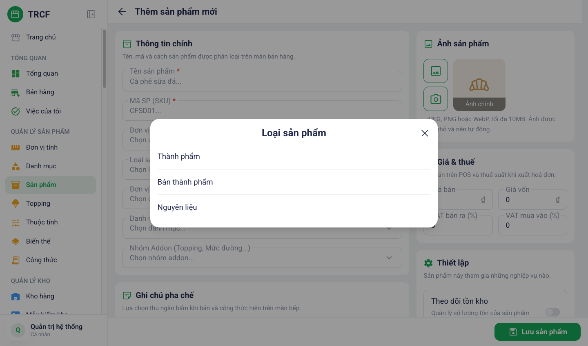
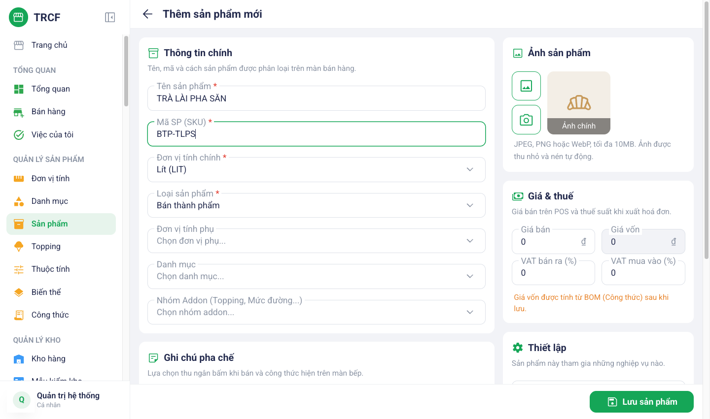
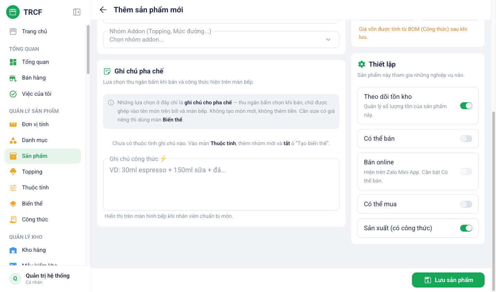

# 2.3 Bán thành phẩm

## 1. Đường dẫn vào chức năng

Menu trái: ==Quản lý sản phẩm → Sản phẩm== (địa chỉ `/products`), bấm nút tròn **+** để mở form thêm mới (`/products/new`).

- Cần có trước: đơn vị tính ([bài 1.1](1-1-thiet-lap-don-vi-tinh.md)).
- Nên có trước: danh mục ([bài 2.1](2-1-danh-muc-san-pham.md)) và nguyên liệu ([bài 2.4](2-4-nguyen-lieu.md)).

> **Cách đặt tên:** BTP - TÊN BÁN THÀNH PHẨM
> 
> - BTP - CỐT TRÀ LÀI
> - BTP - TRÂN CHÂU ĐEN NẤU
> - BTP - MILKFOAM MATCHA

### Công tắc theo loại hàng

| Loại hàng                               | Tồn kho | Có thể bán | Có thể mua | Sản xuất (Có công thức) |
| --------------------------------------- | ------- | ---------- | ---------- | ----------------------- |
| CÀ PHÊ SỮA (THÀNH PHẨM - ĐƯỢC PHA CHẾ)  | ❌       | ✅          | ❌          | ✅                       |
| CÀ PHÊ HẠT (NGUYÊN LIỆU)                | ✅       | ❌          | ✅          | ❌                       |
| CỐT TRÀ LÀI PHA SẴN (BÁN THÀNH PHẨM)    | ✅       | ❌          | ❌          | ✅                       |
| BÁNH (THÀNH PHẨM - MUA SẴN BÁN LẠI)     | ✅       | ✅          | ✅          | ❌                       |

## 2. Ví dụ nền và các bước thực hiện

> **Ví dụ:** quán pha sẵn **TRÀ LÀI PHA SẴN** buổi sáng, tính theo lít, cả ngày múc ra pha.
>
> - Bật **Sản xuất (có công thức)** và **Theo dõi tồn kho**.

### Bước 1: Mở form và chọn Loại sản phẩm

- Ở menu trái, nhóm **Quản lý sản phẩm**, bấm **Sản phẩm**.
- Bấm nút tròn **+** ở góc dưới bên phải.
- Bấm ô **Loại sản phẩm**, chọn **Bán thành phẩm**.

### Bước 2: Khai thông tin chính

- Điền như ảnh.
- Ô **Giá vốn** bị khoá là bình thường.

### Bước 3: Gạt các công tắc và lưu

- Cuộn xuống khung **Thiết lập** (cột phải).
- Gạt công tắc như ảnh. **Có thể bán** mặc định bật, phải gạt tắt.
- Bấm **Lưu sản phẩm**.

## 3. Giải thích các trường

### Khai bán thành phẩm

| Trường                  | Điền gì                                                                     |
| ----------------------- | --------------------------------------------------------------------------- |
| Tên sản phẩm            | Tên hiện trên màn bếp và phiếu chế biến. VD **TRÀ LÀI PHA SẴN**             |
| Mã SP (SKU)             | Mã ngắn để tra cứu, bắt buộc. VD **BTP-TLPS**                               |
| Đơn vị tính chính       | Đơn vị tính tồn. Chất lỏng, bột: **GRAM** hoặc **Lít**                      |
| Loại sản phẩm           | **Bán thành phẩm**                                                          |
| Giá vốn                 | **Bị khoá**, do công thức tính ([bài 3.1](3-1-cong-thuc-ban-thanh-pham.md)) |
| Sản xuất (có công thức) | **Bật**. Có công thức tạo ra bán thành phẩm                                 |
| Theo dõi tồn kho        | **Bật**. Biết bình ủ còn bao nhiêu                                          |
| Có thể bán / Có thể mua | **Tắt**. Không bán trực tiếp, không mua từ nhà cung cấp                     |

### So sánh ba loại hàng

| Loại               | Là gì                                                    | Ví dụ                                 |
| ------------------ | -------------------------------------------------------- | ------------------------------------- |
| **Nguyên liệu**    | Mua để dùng, không bán trực tiếp, dùng làm ra thứ khác   | Cà phê hạt, sữa đặc, đường, ly nhựa   |
| **Bán thành phẩm** | Quán tự làm, chưa bán cho khách, là đầu vào của món khác | Cà phê cốt ủ sẵn, trà ủ, syrup tự nấu |
| **Thành phẩm**     | Món bán cho khách                                        | Cà phê sữa đá, trà đào                |

Công tắc cần bật cho từng loại: xem bảng **Công tắc theo loại hàng** ở đầu bài.

### Khi nào cần bán thành phẩm

Quán pha sẵn một bình trà lài buổi sáng, cả ngày múc ra pha. Tách thành 2 bước:

- **Sáng**: lập phiếu chế biến, trừ trà lài khô, cộng **TRÀ LÀI PHA SẴN** vào kho ([mục 11.4](11-4-che-bien.md)).
- **Cả ngày**: mỗi ly bán ra trừ **TRÀ LÀI PHA SẴN** theo công thức.

## 4. Lưu ý quan trọng

> - Loại sản phẩm chỉ để phân loại, hành vi do các công tắc quyết định.
> - Quán nhỏ có thể bỏ qua bán thành phẩm, cho món trừ thẳng nguyên liệu.
