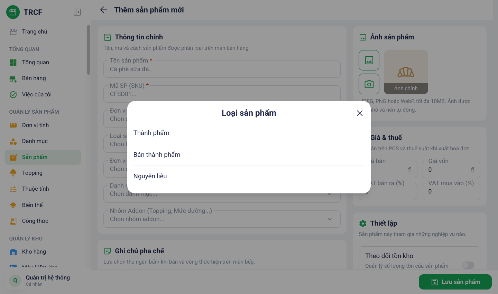
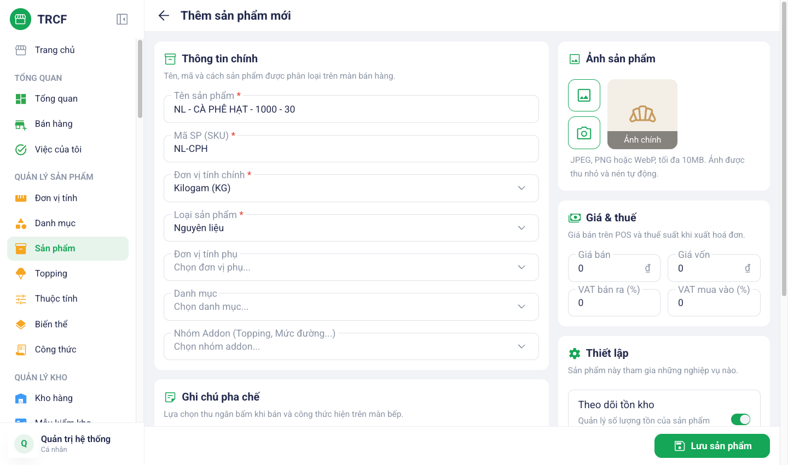
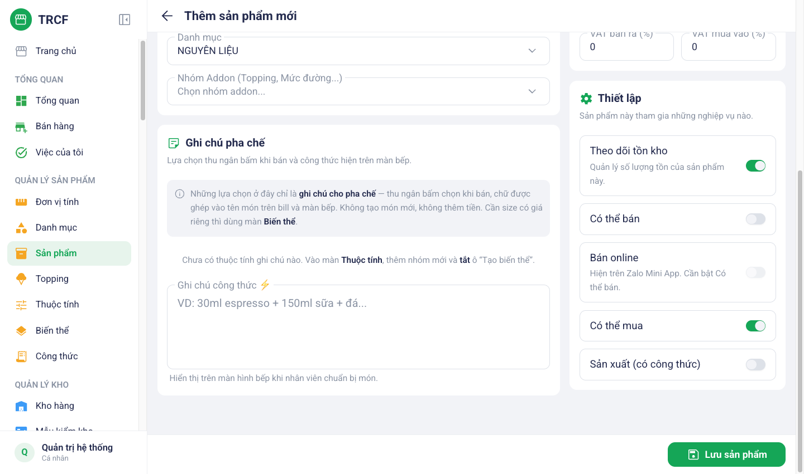

# 2.4 Nguyên liệu

## 1. Đường dẫn vào chức năng

Menu trái: ==Quản lý sản phẩm → Sản phẩm== (địa chỉ `/products`), bấm nút tròn **+** để mở form thêm mới (`/products/new`).

- Cần có trước: đơn vị tính ([bài 1.1](1-1-thiet-lap-don-vi-tinh.md)).

### Công tắc theo loại hàng

| Loại hàng                               | Tồn kho | Có thể bán | Có thể mua | Sản xuất (Có công thức) |
| --------------------------------------- | ------- | ---------- | ---------- | ----------------------- |
| CÀ PHÊ SỮA (THÀNH PHẨM - ĐƯỢC PHA CHẾ)  | ❌       | ✅          | ❌          | ✅                       |
| CÀ PHÊ HẠT (NGUYÊN LIỆU)                | ✅       | ❌          | ✅          | ❌                       |
| CỐT TRÀ LÀI PHA SẴN (BÁN THÀNH PHẨM)    | ✅       | ❌          | ❌          | ✅                       |
| BÁNH (THÀNH PHẨM - MUA SẴN BÁN LẠI)     | ✅       | ✅          | ✅          | ❌                       |

## 2. Ví dụ nền và các bước thực hiện

> **Cách đặt tên**: NL - TÊN NGUYÊN LIỆU - KHỐI LƯỢNG BÊN TRONG - KHỐI LƯỢNG VỎ.
> 
> **Ví dụ cách đặt tên:** 
> - NL - CÀ PHÊ HẠT - 1000 - 30 (Túi khối lượng 1000 GRAM và khối lượng vỏ là 30 GRAM)
> - NL - SỮA ĐẶC - 1250 - 90 (Khối lượng bên trong là 1250 GRAM và khối lượng vỏ hộp là 90 GRAM)
> - NL - SỮA TƯƠI - 1000 - 70

> **Ví dụ:** thêm nguyên liệu **NL - CÀ PHÊ HẠT - 1000 - 30**.
>
> - Mua về, dùng làm ra thứ khác, không bán trực tiếp.
> - Bật **Theo dõi tồn kho** và **Có thể mua**.

### Bước 1: Mở form và chọn Loại sản phẩm

- Ở menu trái, nhóm **Quản lý sản phẩm**, bấm **Sản phẩm**.
- Bấm nút tròn **+** ở góc dưới bên phải.
- Bấm ô **Loại sản phẩm**, chọn **Nguyên liệu**.

### Bước 2: Khai thông tin chính

- Điền như ảnh.
- Đã tạo **GRAM** ở [bài 1.1](1-1-thiet-lap-don-vi-tinh.md) thì **Đơn vị tính chính** nên chọn **GRAM** thay cho **KG**.

### Bước 3: Gạt các công tắc và lưu

- Cuộn xuống khung **Thiết lập** (cột phải).
- Gạt công tắc như ảnh. **Có thể bán** mặc định bật, phải gạt tắt.
- Bấm **Lưu sản phẩm**.

## 3. Giải thích các trường

### Khai nguyên liệu

| Trường                | Điền gì                                                                               |
| --------------------- | ------------------------------------------------------------------------------------- |
| Tên sản phẩm          | VD **NL - CÀ PHÊ HẠT - 1000 - 30**, **NL - SỮA ĐẶC - 1250 - 90**, **NL - ĐƯỜNG CÁT - 1000** |
| Mã SP (SKU)           | Mã ngắn để tra cứu, bắt buộc. VD **NL-CPH**                                           |
| Đơn vị tính chính     | Đơn vị tính tồn. Nên chọn đơn vị nhỏ nhất dùng trừ kho, VD **GRAM**                   |
| Đơn vị tính phụ       | Đơn vị khác dùng cho hàng này (nhập theo **KG**, trừ theo **GRAM**)                   |
| Loại sản phẩm         | **Nguyên liệu**                                                                       |
| Giá vốn               | Giá nhập. Tự cập nhật mỗi lần nhập hàng ([bài 11.2](11-2-nhap-hang.md))               |
| Theo dõi tồn kho      | **Bật**. Hiện ở màn Tồn kho, bị cộng/trừ khi nhập, chế biến, bán, huỷ                 |
| Có thể mua            | **Bật**. Chọn được trong phiếu nhập hàng                                              |
| Có thể bán / Sản xuất | **Tắt**                                                                               |

### So sánh ba loại hàng

| Loại               | Là gì                                                    | Ví dụ                                 |
| ------------------ | -------------------------------------------------------- | ------------------------------------- |
| **Nguyên liệu**    | Mua để dùng, không bán trực tiếp, dùng làm ra thứ khác   | Cà phê hạt, sữa đặc, đường, ly nhựa   |
| **Bán thành phẩm** | Quán tự làm, chưa bán cho khách, là đầu vào của món khác | Cà phê cốt ủ sẵn, trà ủ, syrup tự nấu |
| **Thành phẩm**     | Món bán cho khách                                        | Cà phê sữa đá, trà đào                |

Công tắc cần bật cho từng loại: xem bảng **Công tắc theo loại hàng** ở đầu bài.

## 4. Lưu ý quan trọng

> - Chưa nhập hàng lần nào thì giá vốn là 0, giá vốn món sẽ thiếu.
> - Đơn vị trong công thức được khác đơn vị tồn kho, hệ thống tự quy đổi.
