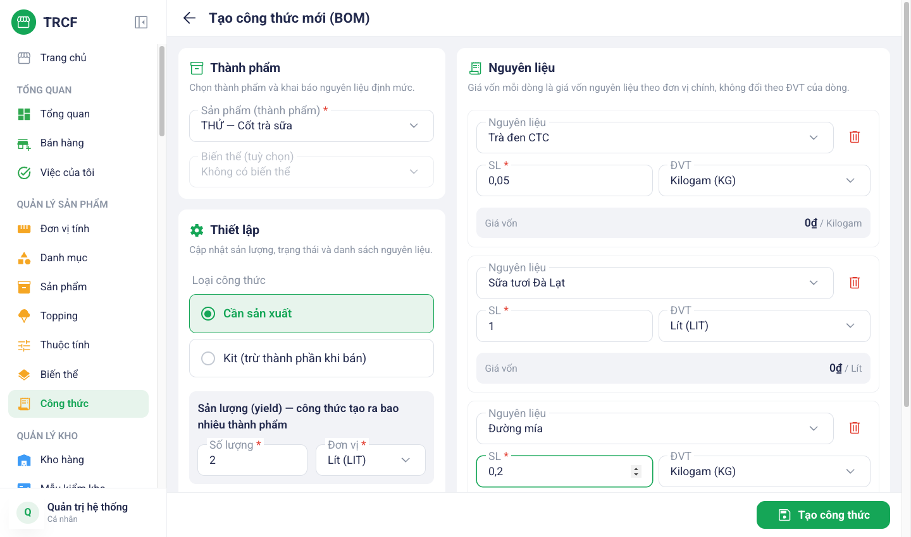

# 3.1 Công thức bán thành phẩm

## 1. Đường dẫn vào chức năng

Menu trái: ==Quản lý sản phẩm → Công thức== (địa chỉ `/boms`).

- Cần có trước: bán thành phẩm bật **Sản xuất** ([bài 2.3](2-3-ban-thanh-pham.md)).
- Cần có trước: nguyên liệu ([bài 2.4](2-4-nguyen-lieu.md)), nên đã nhập hàng để có giá vốn.

### Hai loại công thức

| Loại         | Trừ kho khi nào                                       | Dùng cho                                                               |
| ------------ | ----------------------------------------------------- | ---------------------------------------------------------------------- |
| CẦN SẢN XUẤT | Khi lập **phiếu chế biến** ([11.4](11-4-che-bien.md)) | Bán thành phẩm ủ trước: TRÀ LÀI Ủ SẴN, MILKFOAM, TRÂN CHÂU NẤU SẴN     |
| KIT          | Ngay **lúc bán**, tự trừ thành phần                   | COMBO, MÓN RÁP TẠI CHỖ: CÀ PHÊ ĐEN, CÀ PHÊ SỮA, BẠC XỈU, TRÀ SỮA OLONG |

## 2. Ví dụ nền và các bước thực hiện

> **Ví dụ:** công thức cho bán thành phẩm **THỬ — Cốt trà sữa**, pha một mẻ được 2 lít.
>
> - Nguyên liệu: **Trà đen CTC** 0,05 kg + **Sữa tươi Đà Lạt** 1 lít + **Đường mía** 0,2 kg.
> - Sản lượng 2 lít.

### Bước 1: Tạo công thức

- Ở menu trái, nhóm **Quản lý sản phẩm**, bấm **Công thức**.
- Bấm nút tròn **+** ở góc dưới bên phải.
- **Sản phẩm (thành phẩm)**: bấm vào ô, chọn **THỬ — Cốt trà sữa**.
- **Loại công thức**: giữ **Cần sản xuất**.
- **Sản lượng**: **Số lượng** nhập **2**, **Đơn vị** giữ **Lít (LIT)**.
- Bấm **Thêm nguyên liệu** ba lần (khung *Nguyên liệu*, cột phải).
- Dòng 1: chọn **Trà đen CTC**, **SL** **0,05**, **ĐVT** **Kilogam (KG)**.
- Dòng 2: chọn **Sữa tươi Đà Lạt**, **SL** **1**, **ĐVT** **Lít (LIT)**.
- Dòng 3: chọn **Đường mía**, **SL** **0,2**, **ĐVT** **Kilogam (KG)**.
- Bấm **Tạo công thức** (góc dưới bên phải).

### Bước 2: Tính giá vốn

- Công thức mới có cột **Giá vốn** là *Chưa tính*.
- Bấm vào dòng công thức.
- Chọn **Tính giá vốn**.
- Thấy thông báo *“Đã tính giá vốn công thức”*.
- Cột **Giá vốn** hiện số tiền thay cho *Chưa tính*.
- Tính cả loạt: bấm biểu tượng **Tính lại giá vốn** ở góc trên bên phải.

## 3. Giải thích các trường

### Khai công thức

| Trường                    | Điền gì                                                                | Bắt buộc |
| ------------------------- | ---------------------------------------------------------------------- | -------- |
| Sản phẩm (thành phẩm)     | Món cần công thức. Danh sách **chỉ hiện sản phẩm đã bật *Sản xuất***   | ✅        |
| Biến thể (tuỳ chọn)       | Bỏ trống: công thức chung mọi size. Chọn size: công thức riêng size đó | —        |
| Loại công thức            | Bán thành phẩm thì chọn *Cần sản xuất*                                 | ✅        |
| Sản lượng (yield)         | **Số lượng** + **Đơn vị** công thức làm ra. Pha một mẻ được 2 lít: nhập 2, chọn Lít | ✅        |
| Hoạt động                 | Tắt: công thức tạm ngừng dùng                                          | —        |
| Ghi chú                   | Ghi chú nội bộ cho công thức                                           | —        |
| Nguyên liệu               | Hàng + số lượng (SL) + đơn vị tính (ĐVT)                               | ✅        |

### Cách tính giá vốn

`giá vốn = tổng giá vốn nguyên liệu`

- Sản phẩm có nhiều công thức đang hoạt động: lấy **công thức rẻ nhất**.

## 4. Lưu ý quan trọng

> [!CAUTION]
> **Nguyên liệu có giá vốn = 0 làm giá vốn món sai.**
>
> - Sau khi tính, hệ thống cảnh báo tên nguyên liệu chưa có giá.
> - Giá vốn nguyên liệu tự cập nhật mỗi lần nhập hàng.
> - Nguyên liệu chưa nhập lần nào thì vẫn là 0.

> [!WARNING]
> **Công thức nhiều tầng phải bấm tính hai lần.**
>
> - Ví dụ món trà lài dùng **BTP - TRÀ LÀI**, **BTP - TRÀ LÀI** có công thức riêng.
> - Lần 1: tính giá **BTP - TRÀ LÀI**.
> - Lần 2: đưa giá đó vào món trà lài.

> [!TIP]
> Sửa, tắt hoặc xoá công thức thì giá vốn tự tính lại ngay. Xoá hết công thức đang hoạt động thì giá vốn giữ giá cuối cùng, không tụt về 0.

> [!TIP]
> Đơn vị trong công thức được phép khác đơn vị tồn kho. Khai 18 gram trong khi kho quản lý theo kg vẫn đúng, hệ thống tự quy đổi.

## Kiểm tra đã đúng

- [ ] Công thức có đủ nguyên liệu, đúng định lượng và đơn vị
- [ ] Cột **Giá vốn** của công thức không còn *Chưa tính*
- [ ] Không có cảnh báo nguyên liệu thiếu giá vốn
