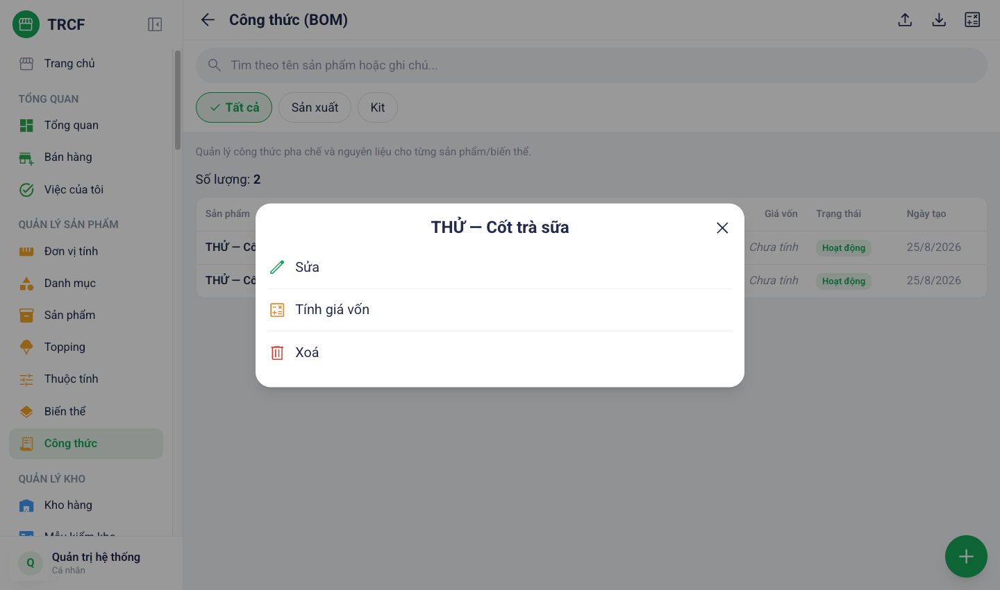

# 3.1 Công thức bán thành phẩm

## 1. Đường dẫn vào chức năng

Menu trái: ==Quản lý sản phẩm → Công thức== (địa chỉ `/boms`).

- Cần có trước: bán thành phẩm bật **Sản xuất** ([bài 2.3](2-3-ban-thanh-pham.md)).
- Cần có trước: nguyên liệu ([bài 2.4](2-4-nguyen-lieu.md)), nên đã nhập hàng để có giá vốn.

### Hai loại công thức

| Loại         | Trừ kho khi nào                                       | Dùng cho                                                               |
| ------------ | ----------------------------------------------------- | ---------------------------------------------------------------------- |
| CẦN SẢN XUẤT | Khi lập **phiếu chế biến** ([11.4](11-4-che-bien.md)) | Bán thành phẩm ủ trước: TRÀ LÀI Ủ SẴN, MILKFOAM, TRÂN CHÂU NẤU SẴN     |
| KIT          | Ngay **lúc bán**, tự trừ thành phần                   | COMBO, MÓN RÁP TẠI CHỖ: CÀ PHÊ ĐEN, CÀ PHÊ SỮA, BẠC XỈU, TRÀ SỮA OLONG |

## 2. Ví dụ nền và các bước thực hiện

> **Ví dụ:** công thức cho bán thành phẩm **THỬ — Cốt trà sữa**, pha một mẻ được 2 lít.
>
> - Nguyên liệu: **Trà đen CTC** 0,05 kg + **Sữa tươi Đà Lạt** 1 lít + **Đường mía** 0,2 kg.
> - Sản lượng 2 lít.

### Bước 1: Tạo công thức

- Ở menu trái, nhóm **Quản lý sản phẩm**, bấm **Công thức**.
- Bấm nút tròn **+** ở góc dưới bên phải.
- Điền cột trái như ảnh.
- Bấm **Thêm nguyên liệu** ba lần (nút nằm cuối khung *Nguyên liệu*), điền từng dòng như ảnh.
- Bấm **Tạo công thức**.

### Bước 2: Tính giá vốn

- Bấm vào dòng công thức (cột **Giá vốn** đang *Chưa tính*), chọn **Tính giá vốn**.
- Thấy thông báo *“Đã tính giá vốn công thức”*, cột **Giá vốn** hiện số tiền.
- Tính cả loạt: bấm biểu tượng **Tính lại giá vốn** ở góc trên bên phải.

## 3. Giải thích các trường

### Khai công thức

| Trường                    | Điền gì                                                                | Bắt buộc |
| ------------------------- | ---------------------------------------------------------------------- | -------- |
| Sản phẩm (thành phẩm)     | Món cần công thức. Danh sách **chỉ hiện sản phẩm đã bật *Sản xuất***   | ✅        |
| Biến thể (tuỳ chọn)       | Bỏ trống: công thức chung mọi size. Chọn size: công thức riêng size đó | —        |
| Loại công thức            | Bán thành phẩm thì chọn *Cần sản xuất*                                 | ✅        |
| Sản lượng (yield)         | **Số lượng** + **Đơn vị** công thức làm ra. Pha một mẻ được 2 lít: nhập 2, chọn Lít | ✅        |
| Hoạt động                 | Tắt: công thức tạm ngừng dùng                                          | —        |
| Ghi chú                   | Ghi chú nội bộ cho công thức                                           | —        |
| Nguyên liệu               | Hàng + số lượng (SL) + đơn vị tính (ĐVT)                               | ✅        |

### Cách tính giá vốn

`giá vốn = tổng giá vốn nguyên liệu`

- Sản phẩm có nhiều công thức đang hoạt động: lấy **công thức rẻ nhất**.

## 4. Lưu ý quan trọng

> - Nguyên liệu giá vốn 0 làm giá vốn món sai: nhập hàng một lần để có giá.
> - Công thức nhiều tầng: tính giá bán thành phẩm trước, rồi mới tính món.
