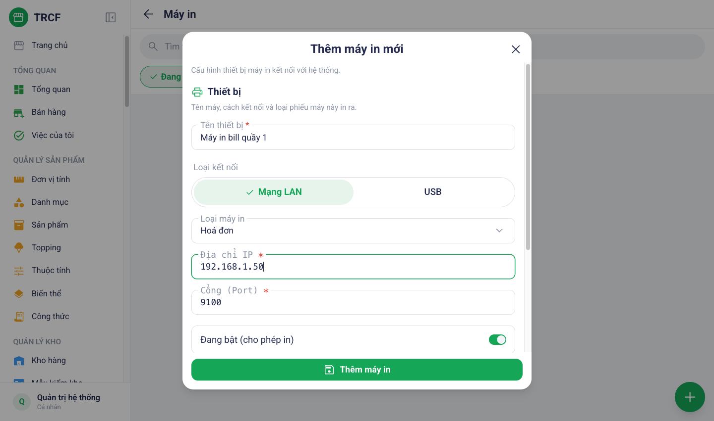
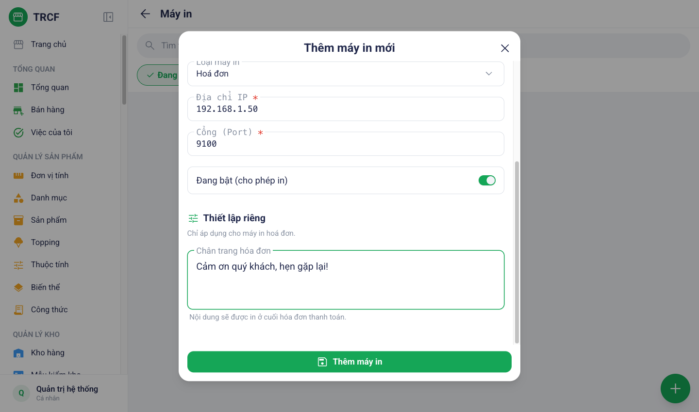

# 4.1 Cài đặt máy in bill

## 1. Đường dẫn vào chức năng

Menu trái: ==Thiết lập cửa hàng → Máy in== (địa chỉ `/printers`).

## 2. Ví dụ nền và các bước thực hiện

> **Ví dụ:** quán có máy in bill ở quầy thu ngân.
>
> - **Máy in bill quầy 1**: loại Hoá đơn, mạng LAN, IP **192.168.1.50**, cổng **9100**.
> - Chân trang bill: **Cảm ơn quý khách, hẹn gặp lại!**

### Bước 1: Mở trang Máy in

- Ở menu trái, nhóm **Thiết lập cửa hàng**, bấm **Máy in**.
- Xem danh sách máy in đang hoạt động (quán mới thì trống).
- Bấm **Đã lưu trữ** hoặc **Tất cả** để xem máy đã cất đi.

### Bước 2: Khai thiết bị

- Bấm nút tròn **+** ở góc dưới bên phải.
- **Tên thiết bị**: nhập **Máy in bill quầy 1**.
- **Loại kết nối**: chọn **Mạng LAN**.
- **Loại máy in**: giữ **Hoá đơn**.
- **Địa chỉ IP**: nhập **192.168.1.50**.
- **Cổng (Port)**: giữ **9100**.
- **Đang bật (cho phép in)**: để **bật**.

### Bước 3: Nhập chân trang và lưu

- Kéo xuống phần **Thiết lập riêng**.
- **Chân trang hóa đơn**: nhập **Cảm ơn quý khách, hẹn gặp lại!**
- Bấm **Thêm máy in**.

## 3. Giải thích các trường

### Thiết bị

| Trường | Điền gì | Bắt buộc |
| --- | --- | --- |
| Tên thiết bị | VD **Máy in bill quầy 1** | ✅ |
| Loại kết nối | *Mạng LAN* (có IP) hoặc *USB* (cắm trực tiếp) | ✅ |
| Loại máy in | *Hoá đơn* / *Nhãn dán (Label)* / *Phiếu yêu cầu món (KOT)* / *Phiếu đóng ca* | ✅ |
| Địa chỉ IP, Cổng (Port) | Chỉ hiện khi chọn LAN. Cổng thường **9100** | ✅ nếu LAN |
| Đang bật (cho phép in) | Tắt: tạm ngừng in ra máy này | — |

### Thiết lập riêng cho máy in hoá đơn

| Trường | Điền gì |
| --- | --- |
| Chân trang hóa đơn | Câu in ở cuối bill |

Sau khi khai máy in, gán máy cho quầy ở ==Thiết lập cửa hàng → Quầy bán hàng==: sửa quầy, chọn máy ở ô **Máy in**.

## 4. Lưu ý quan trọng

> [!WARNING]
> **Máy in nhiệt phổ thông (POS-80) không có bảng mã tiếng Việt.**
>
> - Hệ thống in tiếng Việt bằng cách vẽ ảnh.
> - Bill mất dấu: kiểm tra lại loại máy đã khai.

> [!TIP]
> **Máy in kết nối LAN: kiểm tra máy in và máy tính cùng một mạng.**
>
> - In thử: bấm vào máy in trong danh sách, chọn **In thử**.

## Kiểm tra đã đúng

- [ ] Máy in hiện trong danh sách, trạng thái đang bật
- [ ] Máy LAN đã khai đúng IP và cổng
- [ ] Máy đã gán cho quầy ở **Thiết lập cửa hàng → Quầy bán hàng**
