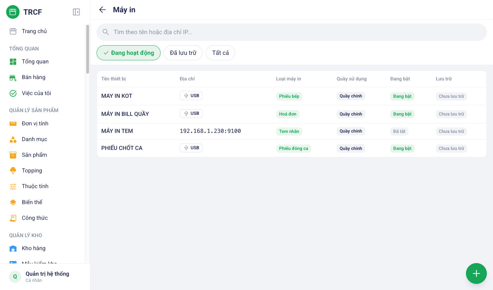

# 4.1 Cài đặt máy in bill

## 1. Đường dẫn vào chức năng

Menu trái: ==Thiết lập cửa hàng → Máy in== (địa chỉ `/printers`).

## 2. Ví dụ nền và các bước thực hiện

> **Ví dụ:** quán có một máy in bill nối mạng LAN ở quầy thu ngân, cuối bill in lời cảm ơn.

### Bước 1: Mở trang Máy in

- Ở menu trái, nhóm **Thiết lập cửa hàng**, bấm **Máy in**.

### Bước 2: Khai thiết bị

- Bấm nút tròn **+** ở góc dưới bên phải.
- Điền như ảnh.
- **Địa chỉ IP**: nhập IP thật của máy in ở quán.

### Bước 3: Nhập chân trang và lưu

- Kéo xuống phần **Thiết lập riêng**.
- Điền như ảnh, bấm **Thêm máy in**.

## 3. Giải thích các trường

### Thiết bị

| Trường | Điền gì | Bắt buộc |
| --- | --- | --- |
| Tên thiết bị | VD **Máy in bill quầy 1** | ✅ |
| Loại kết nối | *Mạng LAN* (có IP) hoặc *USB* (cắm trực tiếp) | ✅ |
| Loại máy in | *Hoá đơn* / *Nhãn dán (Label)* / *Phiếu yêu cầu món (KOT)* / *Phiếu đóng ca* | ✅ |
| Địa chỉ IP, Cổng (Port) | Chỉ hiện khi chọn LAN. Cổng thường **9100** | ✅ nếu LAN |
| Đang bật (cho phép in) | Tắt: tạm ngừng in ra máy này | — |

### Thiết lập riêng cho máy in hoá đơn

| Trường | Điền gì |
| --- | --- |
| Chân trang hóa đơn | Câu in ở cuối bill |

Sau khi khai máy in, gán máy cho quầy ở ==Thiết lập cửa hàng → Quầy bán hàng==: sửa quầy, chọn máy ở ô **Máy in**.

## 4. Lưu ý quan trọng

> - Bill mất dấu tiếng Việt: kiểm tra lại loại máy đã khai.
> - Máy in LAN phải cùng mạng với máy tính.
