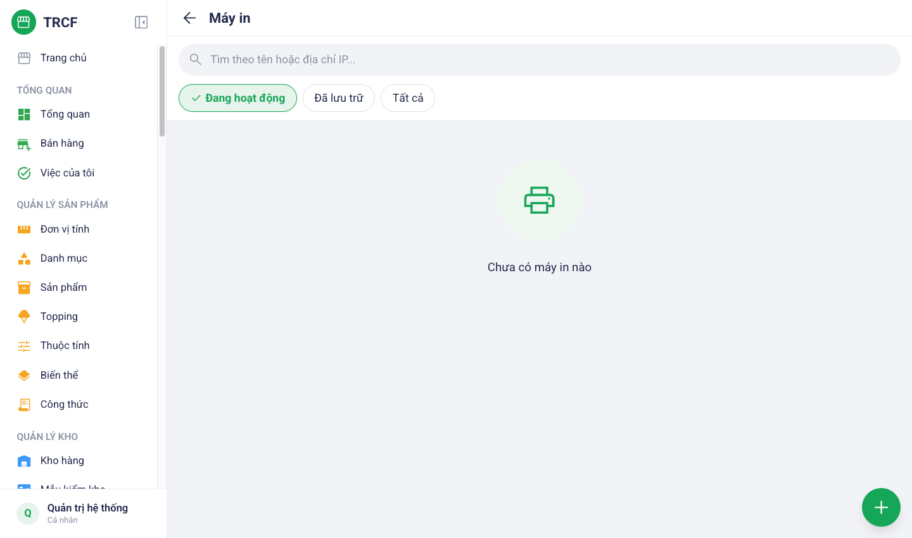
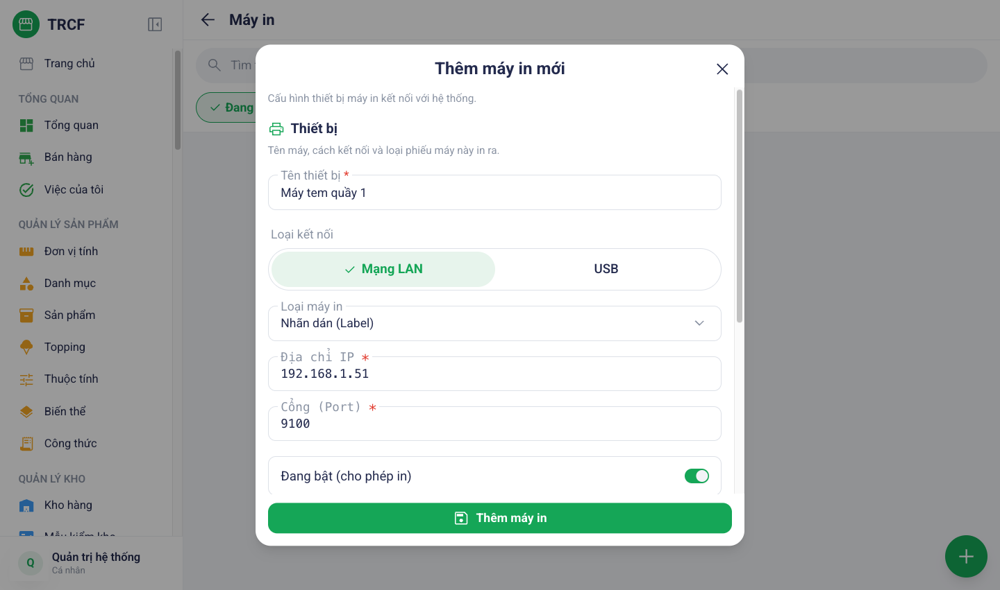
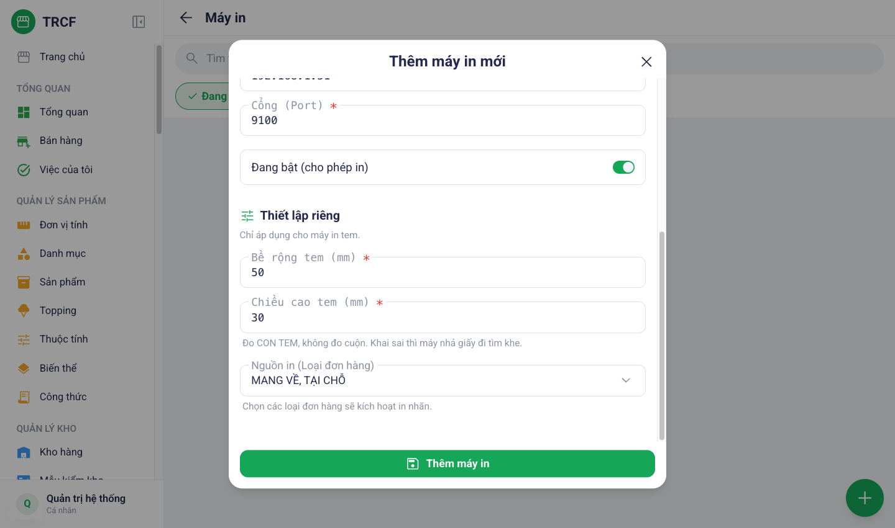
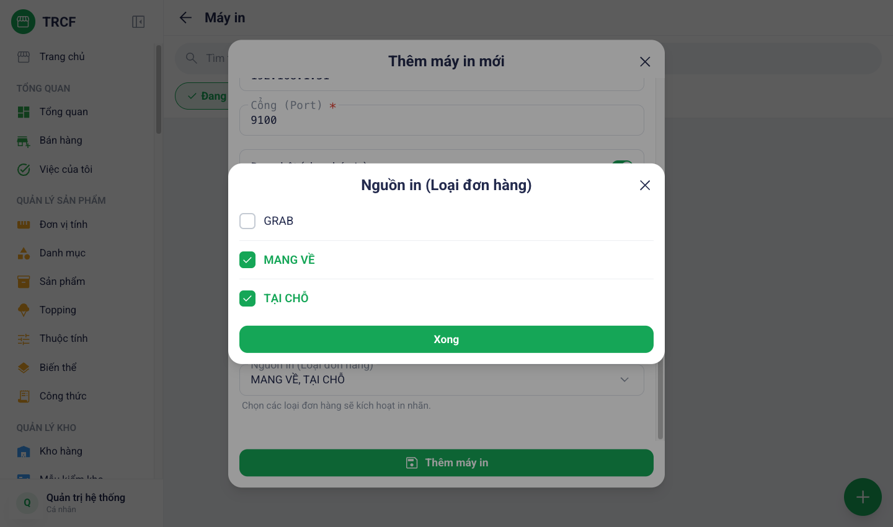

# 4.2 Cài đặt máy in nhãn

## 1. Đường dẫn vào chức năng

Menu trái: ==Thiết lập cửa hàng → Máy in== (địa chỉ `/printers`).

## 2. Ví dụ nền và các bước thực hiện

> **Ví dụ:** quán có máy in tem dán lên ly.
>
> - **Máy tem quầy 1**: loại Nhãn dán, mạng LAN, IP **192.168.1.51**, cổng **9100**.
> - Con tem rộng **50** mm, cao **30** mm (đo con tem thật).
> - In tem cho đơn **MANG VỀ** và **TẠI CHỖ**.

### Bước 1: Mở trang Máy in

- Ở menu trái, nhóm **Thiết lập cửa hàng**, bấm **Máy in**.
- Xem danh sách máy in đang hoạt động (quán mới thì trống).

### Bước 2: Khai thiết bị

- Bấm nút tròn **+** ở góc dưới bên phải.
- **Tên thiết bị**: nhập **Máy tem quầy 1**.
- **Loại kết nối**: chọn **Mạng LAN**.
- **Loại máy in**: bấm vào ô, chọn **Nhãn dán (Label)**.
- **Địa chỉ IP**: nhập **192.168.1.51**.
- **Cổng (Port)**: giữ **9100**.

### Bước 3: Khai cỡ tem

- Kéo xuống phần **Thiết lập riêng**.
- **Bề rộng tem (mm)**: nhập **50**.
- **Chiều cao tem (mm)**: nhập **30**.

### Bước 4: Chọn nguồn in và lưu

- Bấm ô **Nguồn in (Loại đơn hàng)**.
- Tích **MANG VỀ** và **TẠI CHỖ**, bấm **Xong**.
- Bấm **Thêm máy in**.

## 3. Giải thích các trường

### Thiết bị

| Trường | Điền gì | Bắt buộc |
| --- | --- | --- |
| Tên thiết bị | VD **Máy tem quầy 1** | ✅ |
| Loại kết nối | *Mạng LAN* (có IP) hoặc *USB* (cắm trực tiếp) | ✅ |
| Loại máy in | *Hoá đơn* / *Nhãn dán (Label)* / *Phiếu yêu cầu món (KOT)* / *Phiếu đóng ca* | ✅ |
| Địa chỉ IP, Cổng (Port) | Chỉ hiện khi chọn LAN. Cổng thường **9100** | ✅ nếu LAN |
| Đang bật (cho phép in) | Tắt: tạm ngừng in ra máy này | — |

### Thiết lập riêng cho máy in nhãn

| Trường | Điền gì |
| --- | --- |
| Bề rộng tem (mm) | Đo con tem, không đo cuộn. Từ 20 đến 120 mm |
| Chiều cao tem (mm) | Đo con tem, không đo cuộn. Từ 20 đến 120 mm |
| Nguồn in (Loại đơn hàng) | Loại đơn nào thì in tem. Chọn được nhiều loại |

## 4. Lưu ý quan trọng

> [!CAUTION]
> **Chiều cao tem phải đo con tem, không đo cuộn.**
>
> - Khai sai thì máy nhả giấy đi tìm khe cắt.
> - Kết quả là ra tem trắng.

> [!WARNING]
> **Máy in nhiệt phổ thông (POS-80) không có bảng mã tiếng Việt.**
>
> - Hệ thống in tiếng Việt bằng cách vẽ ảnh.
> - Bill mất dấu: kiểm tra lại loại máy đã khai.

## Kiểm tra đã đúng

- [ ] Máy tem hiện trong danh sách, trạng thái đang bật
- [ ] Bề rộng và chiều cao tem khớp con tem thật
- [ ] Đã chọn đúng nguồn in (loại đơn hàng)
