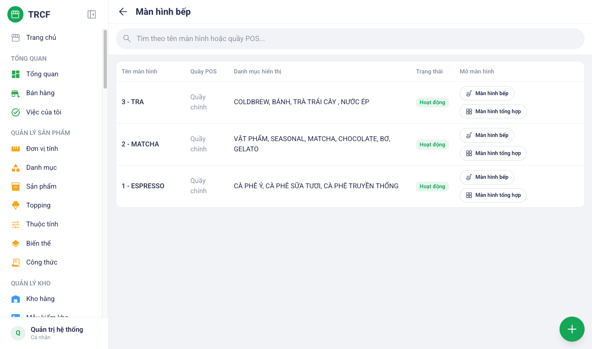
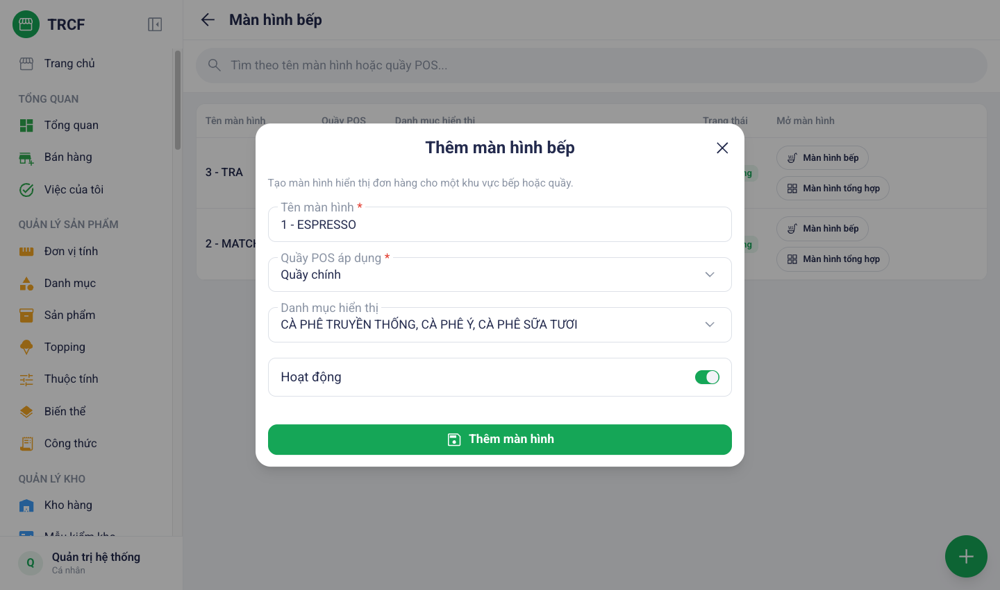
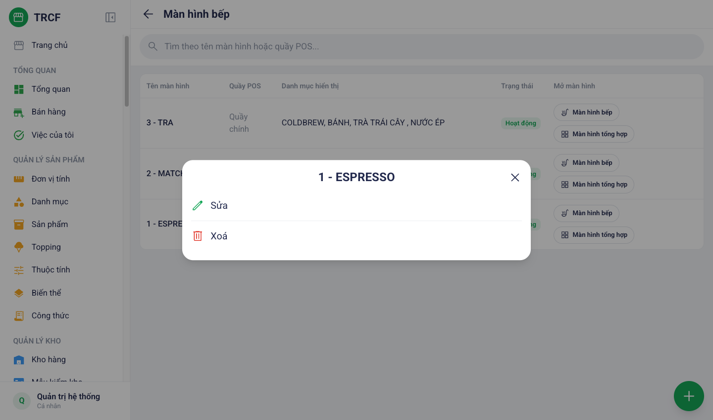
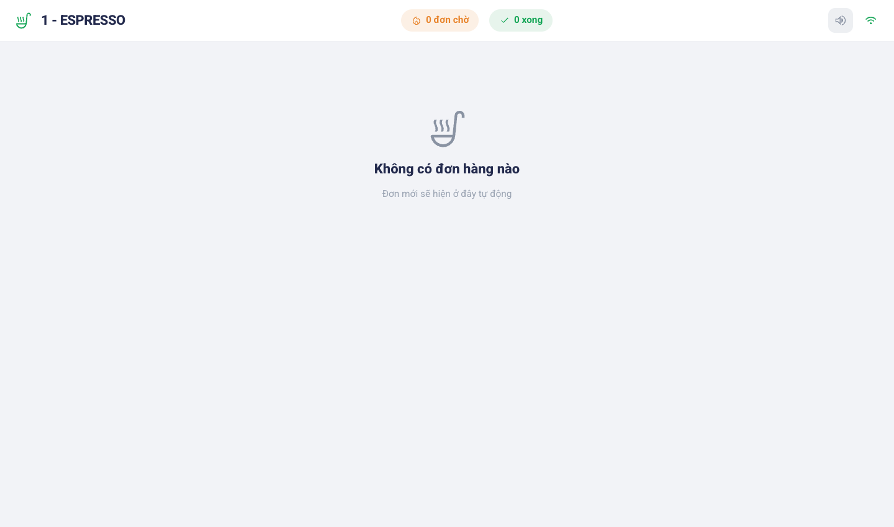

# 5.1 Cài đặt màn hình bếp

## 1. Đường dẫn vào chức năng

Menu trái: ==Thiết lập cửa hàng → Màn hình bếp== (địa chỉ `/kitchen-screens`).

- Cần có trước: quầy bán hàng (khai ở **Thiết lập cửa hàng → Quầy bán hàng**), danh mục sản phẩm ([mục 2.1](2-1-danh-muc-san-pham.md)).

## 2. Ví dụ nền và các bước thực hiện

> **Ví dụ:** quầy pha chế chia 3 khu, mỗi khu một màn hình bếp. Bài này tạo màn của khu máy espresso.
>
> - **1 - ESPRESSO**: CÀ PHÊ TRUYỀN THỐNG, CÀ PHÊ Ý, CÀ PHÊ SỮA TƯƠI.
> - Làm tương tự cho **2 - MATCHA** (MATCHA, CHOCOLATE, BƠ, GELATO, SEASONAL, VẬT PHẨM) và **3 - TRA** (TRÀ TRÁI CÂY, COLDBREW, NƯỚC ÉP, BÁNH).
> - Cả 3 màn nhận đơn của **Quầy chính**.

### Bước 1: Mở trang Màn hình bếp

- Ở menu trái, nhóm **Thiết lập cửa hàng**, bấm **Màn hình bếp**.

### Bước 2: Khai màn hình bếp

- Bấm nút tròn **+** ở góc dưới bên phải.
- Ô **Danh mục hiển thị**: bấm vào, tích danh mục (chọn được nhiều), bấm **Xong**.
- Điền như ảnh, bấm **Thêm màn hình**.

### Bước 3: Kiểm tra kết quả

- Màn hình vừa tạo hiện trong danh sách.
- Đổi ý sau này: bấm vào tên màn hình, chọn **Sửa**.

### Bước 4: Mở màn hình bếp trên thiết bị

- Bấm **Màn hình bếp** trên dòng vừa tạo. Màn hình mở ở tab mới (địa chỉ dạng `/kitchen/…`).
- Mở trên thiết bị ở khu pha chế, **để nguyên cả ngày**.

## 3. Giải thích các trường

| Trường | Điền gì | Bắt buộc |
| --- | --- | --- |
| Tên màn hình | Đặt theo khu pha chế. VD **1 - ESPRESSO**, **2 - MATCHA**, **3 - TRA** | ✅ |
| Quầy POS áp dụng | Màn này **chỉ nhận đơn của quầy đó** | ✅ |
| Danh mục hiển thị | Nhóm món màn này phụ trách. Để trống: nhận mọi món | — |
| Hoạt động | Tắt: ngừng dùng màn này | — |

### Món hiện gì trên màn bếp

| Thông tin | Từ đâu ra |
| --- | --- |
| Tên món + ghi chú trong ngoặc. VD *MAY ĐEN ĐÁ (ÍT ĐÁ)* | Thuộc tính |
| Số lượng | Đơn hàng |
| Ghi chú của khách | Thu ngân nhập lúc bán |
| **Ghi chú công thức ⚡** | Trường khai ở [mục 2.2](2-2-thanh-pham.md) |

Pha chế xong: bấm vào món, món biến khỏi màn.

## 4. Lưu ý quan trọng

> - Mỗi màn hình bếp chỉ nhận đơn của **một quầy**.
> - Đơn huỷ hoặc đã hoàn tự biến khỏi màn bếp.
