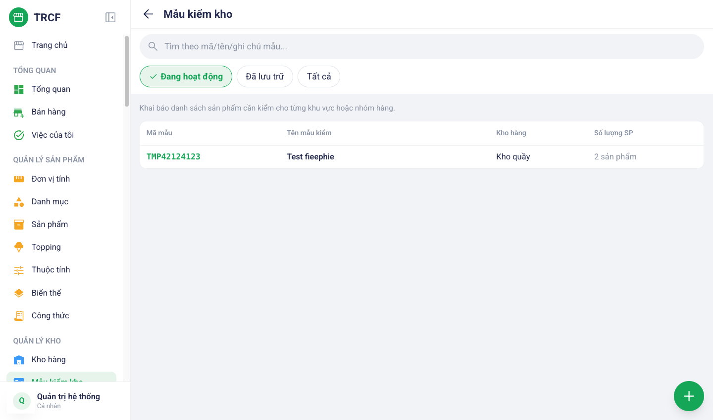
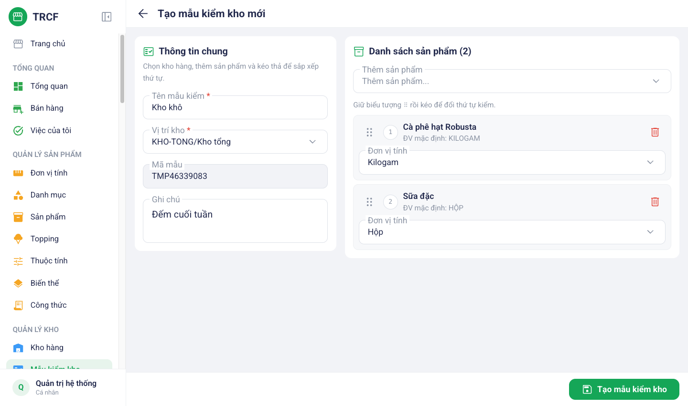
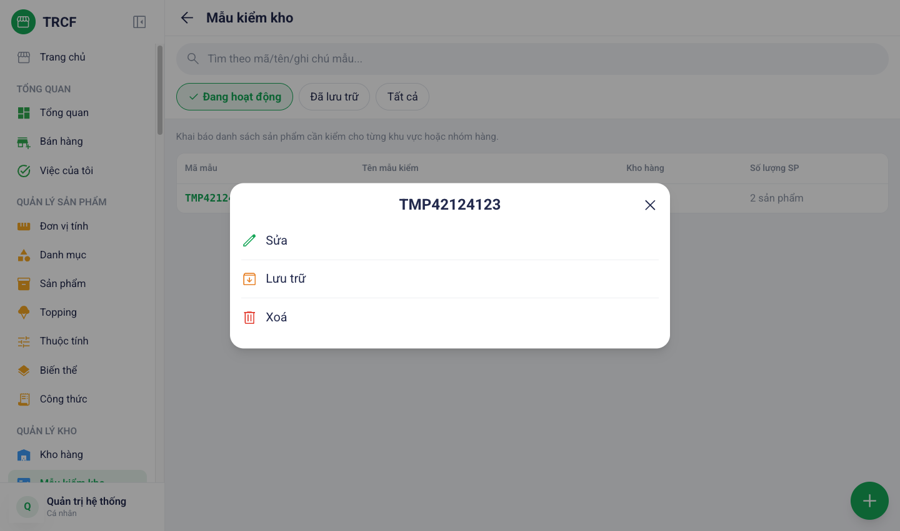

# 6.1 Tạo mẫu kiểm kho

## 1. Đường dẫn vào chức năng

Menu trái: ==Quản lý kho → Mẫu kiểm kho== (địa chỉ `/stock-templates`).

- Cần có trước: kho hàng và sản phẩm đã bật **Theo dõi tồn kho** ([bài 2.4](2-4-nguyen-lieu.md)).
- Mẫu dùng để tạo phiếu kiểm kho nhanh ở [bài 11.6](11-6-kiem-kho.md).

## 2. Ví dụ nền và các bước thực hiện

> **Ví dụ:** mẫu đếm hàng khô cuối tuần cho **Kho tổng**.
>
> - Tên: **Kho khô**. Kho: **Kho tổng**. Ghi chú: **Đếm cuối tuần**.
> - Danh sách: **Cà phê hạt Robusta**, **Sữa đặc**.

### Bước 1: Mở trang Mẫu kiểm kho

- Ở menu trái, nhóm **Quản lý kho**, bấm **Mẫu kiểm kho**.
- Xem danh sách mẫu: mã mẫu, tên, kho hàng, số lượng sản phẩm.
- Bấm **Đã lưu trữ** hoặc **Tất cả** để xem mẫu đã cất đi.

### Bước 2: Khai mẫu và thêm sản phẩm

- Bấm nút tròn **+** ở góc dưới bên phải. Trang **Tạo mẫu kiểm kho mới** mở ra.
- **Tên mẫu kiểm**: nhập **Kho khô**.
- **Vị trí kho**: bấm vào ô, chọn **KHO-TONG/Kho tổng**.
- **Mã mẫu**: hệ thống tự sinh, không sửa.
- **Ghi chú**: nhập **Đếm cuối tuần**.
- Bấm ô **Thêm sản phẩm...**, chọn **Cà phê hạt Robusta**.
- Bấm ô đó lần nữa, chọn **Sữa đặc**.
- Giữ biểu tượng ⠿ rồi kéo để đổi thứ tự dòng.
- **Đơn vị tính** của mỗi dòng: tự lấy đơn vị mặc định của sản phẩm. Bấm vào để đổi đơn vị đếm.
- Bấm **Tạo mẫu kiểm kho** ở góc dưới bên phải.

### Bước 3: Kiểm tra kết quả

- Mẫu hiện trong danh sách: mã mẫu, tên, kho, số lượng sản phẩm.
- Mẫu **Kho khô** hiện **2 sản phẩm**.
- Đổi ý sau này: bấm vào mẫu, chọn **Sửa**. Ngừng dùng: chọn **Lưu trữ**.

## 3. Giải thích các trường

| Trường | Điền gì | Bắt buộc |
| --- | --- | --- |
| Tên mẫu kiểm | Tên mẫu, đặt theo khu vực. VD **Kho khô**, **Quầy pha chế** | ✅ |
| Vị trí kho | Kho sẽ đếm bằng mẫu này | ✅ |
| Mã mẫu | Tự sinh, chỉ đọc | — |
| Ghi chú | Ghi thêm, VD lịch đếm | — |
| Danh sách sản phẩm | Hàng cần đếm. Thêm từng món, kéo ⠿ để xếp thứ tự, bấm thùng rác để bỏ dòng | ✅ |
| Đơn vị tính (mỗi dòng) | Đơn vị đếm của dòng đó. Mặc định là đơn vị của sản phẩm | — |

## 4. Lưu ý quan trọng

> [!WARNING]
> **Mẫu kiểm kho chưa phải phiếu đếm.**
>
> - Mẫu chỉ là danh sách hàng cần đếm.
> - Phiếu đếm hàng thật tạo ở [bài 11.6](11-6-kiem-kho.md).

> [!TIP]
> **Dựng mẫu theo khu vực**: **Quầy pha chế**, **Kho khô**, **Tủ đông**.
>
> - Đếm theo khu nhanh và ít sót hơn đếm theo danh sách toàn quán.

> [!TIP]
> Xếp hàng theo thứ tự đặt trên kệ để người đếm đi một vòng là xong.

## Kiểm tra đã đúng

- [ ] Mẫu hiện trong danh sách với đúng kho
- [ ] Số sản phẩm của mẫu đúng như đã chọn
