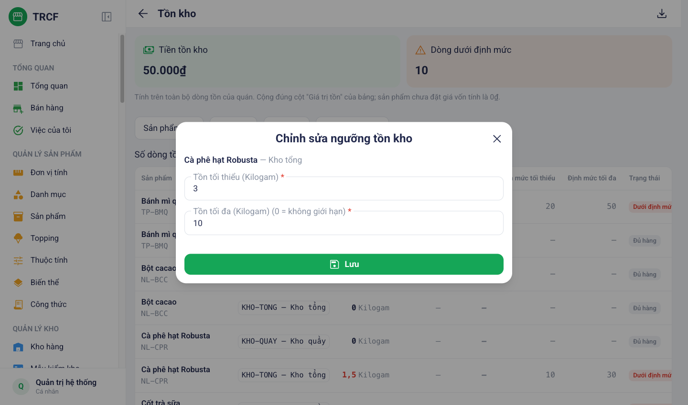

# 6.2 Định mức tối thiểu - tối đa của sản phẩm

## 1. Đường dẫn vào chức năng

Menu trái: ==Quản lý kho → Tồn kho== (địa chỉ `/stock`).

- Cần có trước: sản phẩm bật **Theo dõi tồn kho** ([bài 2.4](2-4-nguyen-lieu.md)).
- Mỗi sản phẩm theo dõi tồn kho có một dòng ở mỗi kho, tồn ban đầu là 0.

## 2. Ví dụ nền và các bước thực hiện

> **Ví dụ:** khai định mức cho **Cà phê hạt Robusta** ở **Kho tổng**, đơn vị Kilogam.
>
> - Tồn tối thiểu: **3** kg. Tồn tối đa: **10** kg.
> - Hàng giao trong 2 ngày, mỗi ngày dùng 1 kg: tối thiểu là 1 × 2 × 1,5 = 3 kg.

### Bước 1: Mở trang Tồn kho

- Ở menu trái, nhóm **Quản lý kho**, bấm **Tồn kho**.
- Tìm dòng **Cà phê hạt Robusta** ở kho **KHO-TONG — Kho tổng**. Mỗi dòng là một sản phẩm ở một kho.

### Bước 2: Khai định mức

- Bấm vào dòng đó.
- Điền như ảnh, bấm **Lưu**.

### Bước 3: Kiểm tra kết quả

- Thấy thông báo *“Đã cập nhật ngưỡng tồn kho”*.
- Tồn thấp hơn tối thiểu thì dòng hiện **Dưới định mức** và được đếm vào ô **Dòng dưới định mức**.
- Bấm nút **Dưới định mức** để chỉ xem các dòng cần nhập thêm. Bấm **Xoá bộ lọc** để xem lại tất cả.

## 3. Giải thích các trường

| Trường | Điền gì |
| --- | --- |
| Tồn tối thiểu | Xuống dưới mức này là phải đặt hàng. Bằng 0: không cảnh báo |
| Tồn tối đa | Mức đầy kho. Hệ thống dùng để gợi ý đặt bao nhiêu. Bằng **0**: không giới hạn |

Công thức đặt tồn tối thiểu: `lượng dùng trung bình mỗi ngày × số ngày nhà cung cấp giao hàng × 1,5`.

## 4. Lưu ý quan trọng

> - Chưa khai định mức thì không có cảnh báo nhập hàng.
> - Định mức khai riêng cho từng kho.
