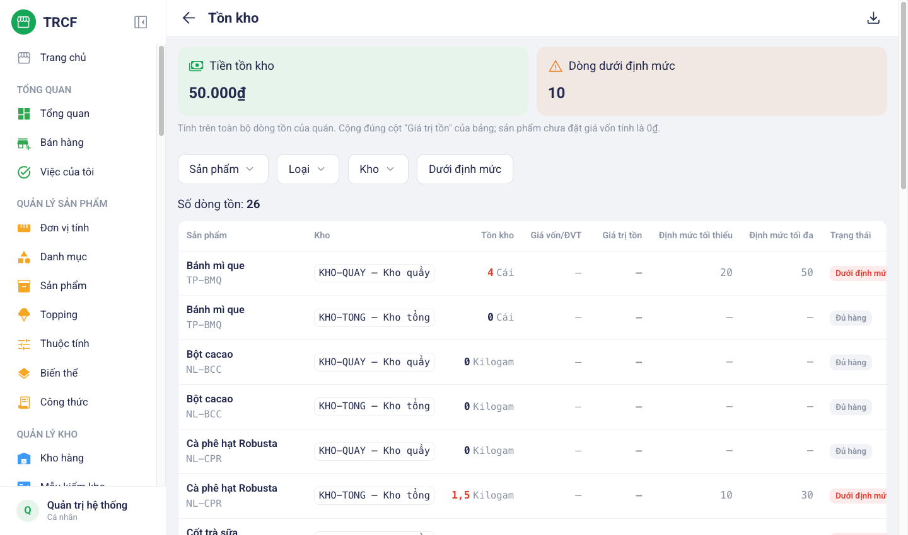
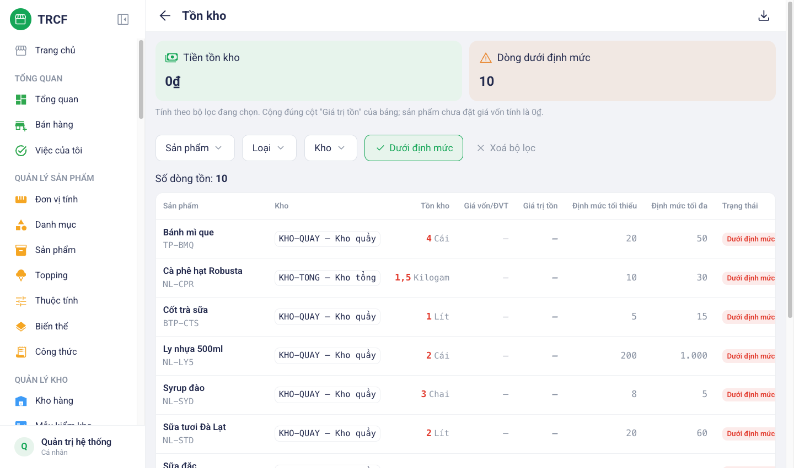

# 6.2 Định mức tối thiểu - tối đa của sản phẩm

## 1. Đường dẫn vào chức năng

Menu trái: ==Quản lý kho → Tồn kho== (địa chỉ `/stock`).

- Cần có trước: sản phẩm bật **Theo dõi tồn kho** ([bài 2.4](2-4-nguyen-lieu.md)).
- Mỗi sản phẩm theo dõi tồn kho có một dòng ở mỗi kho, tồn ban đầu là 0.

## 2. Ví dụ nền và các bước thực hiện

> **Ví dụ:** khai định mức cho **Cà phê hạt Robusta** ở **Kho tổng**, đơn vị Kilogam.
>
> - Tồn tối thiểu: **3** kg. Tồn tối đa: **10** kg.
> - Hàng giao trong 2 ngày, mỗi ngày dùng 1 kg: tối thiểu là 1 × 2 × 1,5 = 3 kg.

### Bước 1: Mở trang Tồn kho

- Ở menu trái, nhóm **Quản lý kho**, bấm **Tồn kho**.
- Đọc 2 ô: **Tiền tồn kho**, **Dòng dưới định mức**.
- Mỗi dòng là một sản phẩm ở một kho: tồn kho, giá vốn, giá trị tồn, định mức tối thiểu, định mức tối đa, trạng thái.
- Lọc nhanh bằng các nút **Sản phẩm**, **Loại**, **Kho**.
- Tìm dòng **Cà phê hạt Robusta — KHO-TONG — Kho tổng**.

### Bước 2: Khai định mức

- Bấm vào dòng đó.
- Hộp thoại **Chỉnh sửa ngưỡng tồn kho** mở ra, ghi tên sản phẩm và kho.
- **Tồn tối thiểu (Kilogam)**: nhập **3**.
- **Tồn tối đa (Kilogam)**: nhập **10**.
- Bấm **Lưu**.

### Bước 3: Kiểm tra kết quả

- Thấy thông báo *“Đã cập nhật ngưỡng tồn kho”*.
- Dòng vừa khai hiện số mới ở cột **Định mức tối thiểu**, **Định mức tối đa**.
- Tồn thấp hơn tối thiểu: trạng thái **Dưới định mức** (nhãn đỏ), ô **Dòng dưới định mức** đếm cả dòng này.
- Bấm nút **Dưới định mức** để chỉ xem các dòng cần nhập thêm. Bấm **Xoá bộ lọc** để xem lại tất cả.

## 3. Giải thích các trường

| Trường | Điền gì |
| --- | --- |
| Tồn tối thiểu | Xuống dưới mức này là phải đặt hàng. Bằng 0: không cảnh báo |
| Tồn tối đa | Mức đầy kho. Hệ thống dùng để gợi ý đặt bao nhiêu. Bằng **0**: không giới hạn |

Công thức đặt tồn tối thiểu: `lượng dùng trung bình mỗi ngày × số ngày nhà cung cấp giao hàng × 1,5`. Hàng giao trong 2 ngày, mỗi ngày dùng 1 kg: tối thiểu **3 kg**.

## 4. Lưu ý quan trọng

> [!CAUTION]
> **Khai định mức trước thì cảnh báo nhập hàng mới có tác dụng.**
>
> - Chưa khai thì không có gì để so.

> [!WARNING]
> **Định mức khai theo từng kho.**
>
> - Cùng một sản phẩm ở **Kho tổng** và **Kho quầy** có hai dòng, khai riêng từng dòng.
> - Đơn vị ghi ngay trong nhãn ô, VD *Tồn tối thiểu (Kilogam)*.

> [!TIP]
> Mặt hàng dưới định mức được đánh dấu **Dưới định mức** và đếm vào ô *Sản phẩm dưới định mức* ở màn Tổng quan.

## Kiểm tra đã đúng

- [ ] Đã khai tồn tối thiểu / tối đa cho hàng quan trọng
- [ ] Dòng đã khai hiện đúng số ở cột định mức
