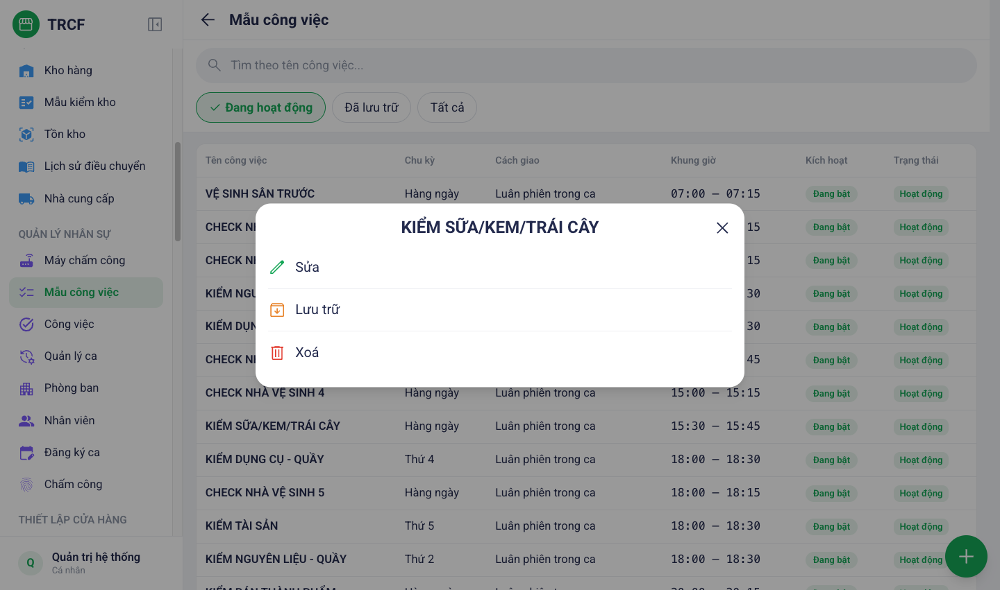

# 7.1 Mẫu công việc

## 1. Đường dẫn vào chức năng

Menu trái: ==Quản lý nhân sự → Mẫu công việc== (địa chỉ `/task-templates`).

## 2. Ví dụ nền và các bước thực hiện

> **Ví dụ:** mỗi chiều 15:30–15:45, một người trong ca đếm sữa, bánh, trái cây, kem ở quầy theo mẫu kiểm kho SỮA/BÁNH/TRÁI CÂY/KEM ([mục 6.1](6-1-tao-mau-kiem-kho.md)).
>
> - Mẫu: **KIỂM SỮA/KEM/TRÁI CÂY**, chu kỳ **Hàng ngày**, cách giao **Luân phiên trong ca**.
> - Việc theo thứ trong tuần làm tương tự, VD **KIỂM NGUYÊN LIỆU - KHO** chọn **Thứ trong tuần** → **Thứ 2**, 12:00–12:30.

### Bước 1: Mở trang Mẫu công việc

- Ở menu trái, nhóm **Quản lý nhân sự**, bấm **Mẫu công việc**.

### Bước 2: Khai nội dung công việc

- Bấm nút tròn **+** ở góc dưới bên phải.
- Điền như ảnh. Chưa bấm lưu.

### Bước 3: Khai lịch lặp lại và cách giao

- Kéo xuống phần **Lịch lặp lại**.
- Điền như ảnh, bấm **Thêm mẫu công việc**.

### Bước 4: Kiểm tra mẫu

- Mẫu vừa tạo hiện trong danh sách, cột **Kích hoạt** là **Đang bật**.
- Đổi ý sau này: bấm vào mẫu, chọn **Sửa**. Ngừng dùng hẳn: chọn **Lưu trữ**.

## 3. Giải thích các trường

### Mẫu công việc

| Trường | Điền gì | Bắt buộc |
| --- | --- | --- |
| Tên công việc | VD **KIỂM SỮA/KEM/TRÁI CÂY**, **VỆ SINH SÂN TRƯỚC** | ✅ |
| Kích hoạt (dùng khi sinh phân công) | Tắt: tạm ngừng, không sinh việc nữa | — |
| Mô tả | Hướng dẫn cho người làm: làm gì, ở đâu, xong thì báo ai | — |
| Chu kỳ | *Hàng ngày* / *Thứ trong tuần* / *Hàng tháng* | ✅ |
| Thứ **hoặc** Ngày trong tháng | Chỉ hiện khi chọn chu kỳ tương ứng | ✅ theo chu kỳ |
| Giờ bắt đầu, Giờ kết thúc | Khung giờ nên làm việc này | ✅ |
| Cách giao | Bấm vào ô để chọn. Xem bảng dưới | ✅ |

### Ba cách giao

| Cách giao | Ai nhận việc |
| --- | --- |
| Luân phiên trong ca | Chia lần lượt cho những người có ca |
| Giao theo phòng ban | Chỉ chia cho người thuộc phòng ban đã chọn |
| Giao cố định cá nhân | Luôn giao cho một người đã chọn |

Mọi cách giao đều ưu tiên người có ca phủ đúng khung giờ. Không ai khớp giờ thì việc vẫn được giao và ghi lại lý do.

## 4. Lưu ý quan trọng

> - Tạm ngừng một việc: tắt **Kích hoạt**, đừng xoá.
