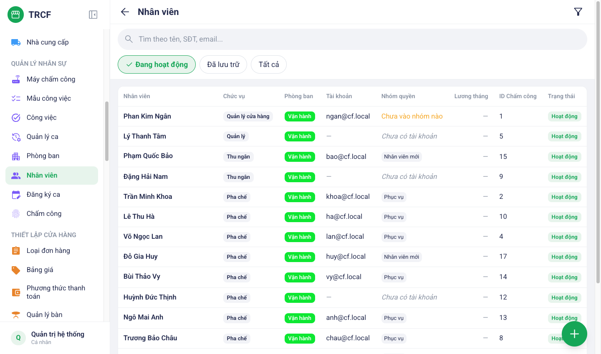
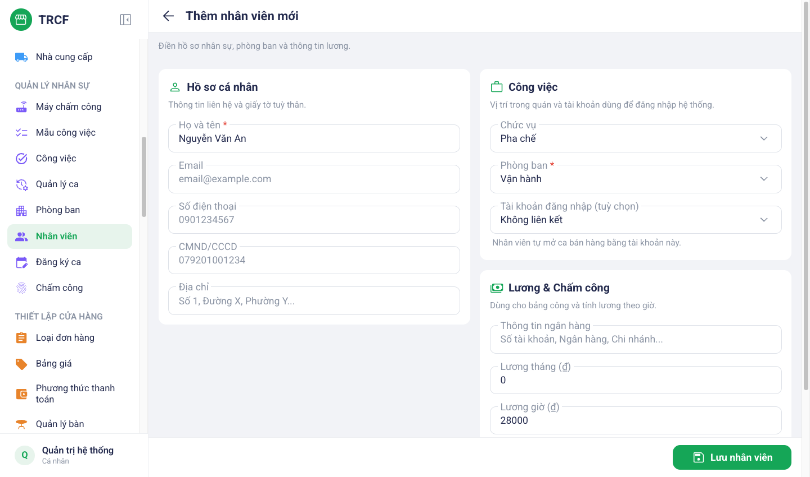
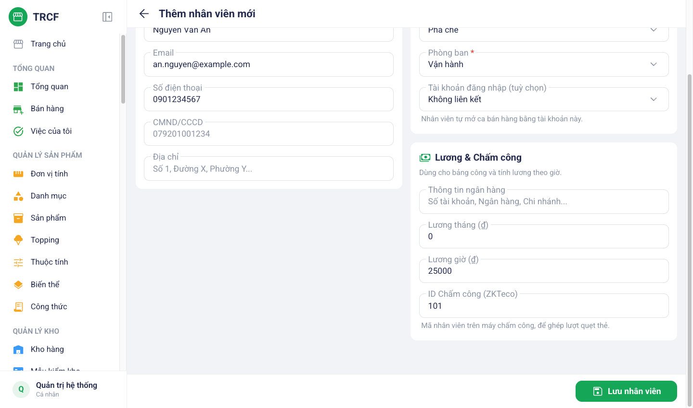
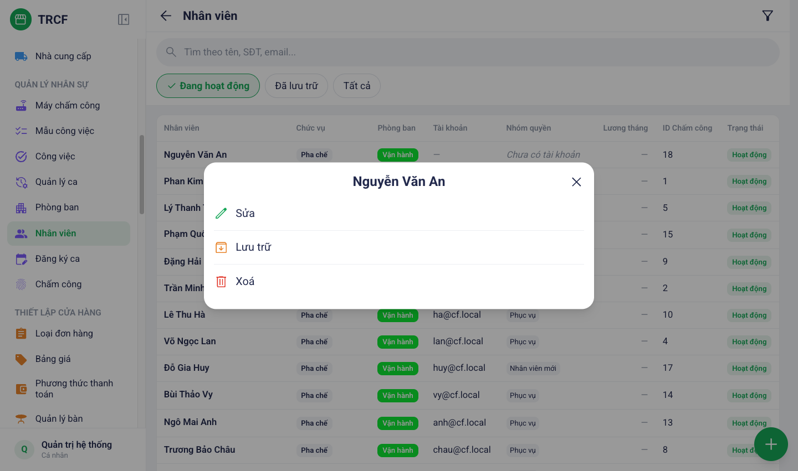

# 8.1 Tạo nhân viên

## 1. Đường dẫn vào chức năng

Menu trái: ==Quản lý nhân sự → Nhân viên== (địa chỉ `/employees`, trang thêm mới `/employees/new`).

- Cần có trước: phòng ban (==Quản lý nhân sự → Phòng ban==).
- Thứ tự bước 8 và 9: nhân viên → máy chấm công ([8.2](8-2-cai-dat-may-cham-cong.md)) → ca làm việc ([9.1](9-1-tao-ca-lam-viec.md)) → đăng ký và duyệt ca ([9.2](9-2-dang-ky-va-duyet-ca.md)) → đồng bộ chấm công ([9.3](9-3-dong-bo-cham-cong.md)).

## 2. Ví dụ nền và các bước thực hiện

> **Ví dụ:** thêm nhân viên pha chế **Nguyễn Văn An**.
>
> - Chức vụ: **Pha chế**. Phòng ban: **Vận hành**.
> - ID Chấm công: **101** (khớp mã trên máy chấm công). Lương giờ: **25000**.

### Bước 1: Mở trang Nhân viên

- Ở menu trái, nhóm **Quản lý nhân sự**, bấm **Nhân viên**.

### Bước 2: Khai hồ sơ và công việc

- Bấm nút tròn **+** ở góc dưới bên phải.
- Điền như ảnh. Chưa bấm lưu.
- **Tài khoản đăng nhập (tuỳ chọn)**: người này đứng quầy thì chọn tài khoản của họ, không thì giữ **Không liên kết**.

### Bước 3: Khai lương và chấm công

- Kéo xuống phần **Lương & Chấm công**.
- Điền như ảnh, bấm **Lưu nhân viên**.

### Bước 4: Kiểm tra kết quả

- Nhân viên vừa tạo hiện trong danh sách, cột **ID Chấm công** hiện mã vừa nhập.
- Cột **Tài khoản** hiện dấu — nghĩa là chưa gắn tài khoản đăng nhập.
- Đổi thông tin sau này: bấm vào nhân viên, chọn **Sửa**.

## 3. Giải thích các trường

### Hồ sơ cá nhân

| Trường | Điền gì | Bắt buộc |
| --- | --- | --- |
| Họ và tên | Tên đầy đủ | ✅ |
| Email, Số điện thoại, CMND/CCCD, Địa chỉ | Thông tin liên hệ | — |

### Công việc

| Trường | Điền gì | Bắt buộc |
| --- | --- | --- |
| Chức vụ | Bấm vào ô để chọn: Pha chế, Thu ngân, Phục vụ, Quản lý, Kho, Marketing | — |
| Phòng ban | Bấm vào ô để chọn. Khai trước ở *Phòng ban* | ✅ |
| **Tài khoản đăng nhập (tuỳ chọn)** | Gắn hồ sơ với một tài khoản hệ thống. **Không gắn thì không mở ca được** | Bắt buộc nếu người này đứng quầy |

### Lương & Chấm công

| Trường | Điền gì |
| --- | --- |
| Thông tin ngân hàng | Số tài khoản, ngân hàng, chi nhánh |
| Lương tháng (₫) | Lương cố định |
| Lương giờ (₫) | Dùng để tính tiền công theo bảng chấm công |
| **ID Chấm công (ZKTeco)** | Mã nhân viên **trên máy chấm công**. Phải khớp |

## 4. Lưu ý quan trọng

> - Chưa gắn **Tài khoản đăng nhập** thì người đó không mở được ca.
> - **ID chấm công** sai hoặc trống thì lượt quẹt không ghép được vào ai.
> - Lương, CCCD, số tài khoản chỉ hiện với người có quyền sửa nhân viên.
