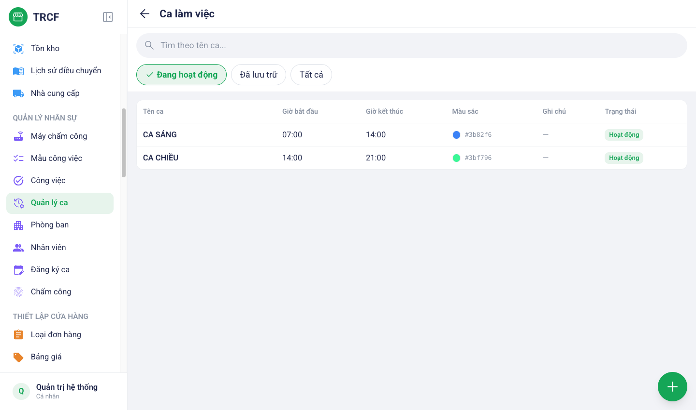
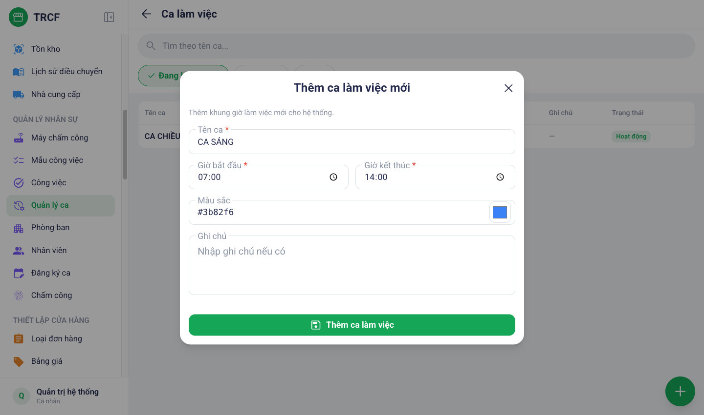
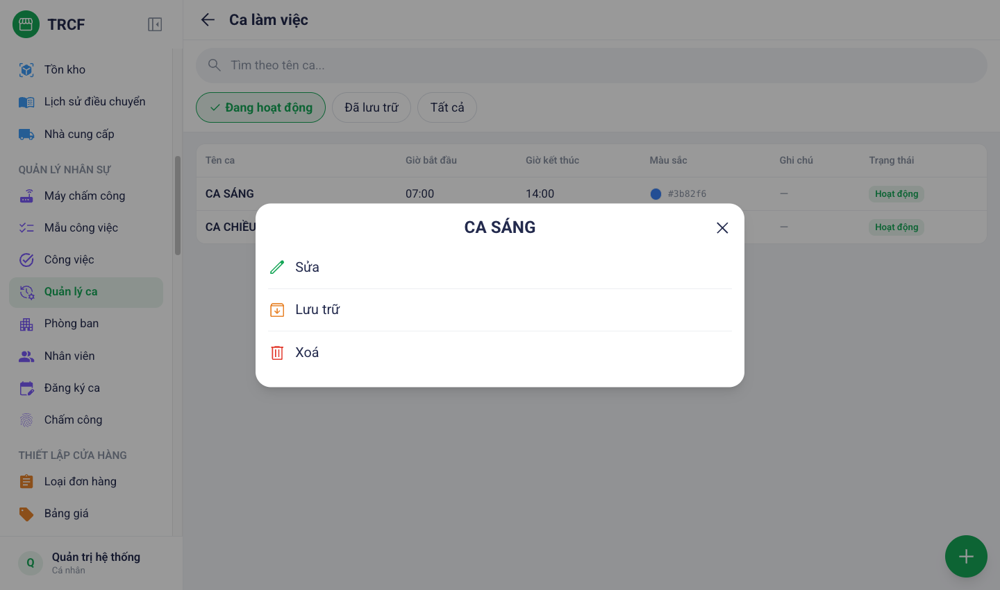

# 9.1 Tạo ca làm việc

## 1. Đường dẫn vào chức năng

Menu trái: ==Quản lý nhân sự → Quản lý ca== (địa chỉ `/shifts`, tiêu đề trang **Ca làm việc**).

## 2. Ví dụ nền và các bước thực hiện

> **Ví dụ:** quán có 2 ca.
>
> - **Ca sáng**: từ **07:00** đến **12:00**.
> - **Ca qua đêm**: từ **22:00** đến **06:00** (giờ kết thúc sớm hơn giờ bắt đầu, vẫn hợp lệ).

### Bước 1: Mở trang Ca làm việc

- Ở menu trái, nhóm **Quản lý nhân sự**, bấm **Quản lý ca**.

### Bước 2: Khai Ca sáng

- Bấm nút tròn **+** ở góc dưới bên phải.
- Điền như ảnh, bấm **Thêm ca làm việc**.

### Bước 3: Kiểm tra kết quả

- Ca hiện trong danh sách với đúng khung giờ.
- Lặp lại bước 2 cho từng ca khác, kể cả ca qua đêm (22:00 → 06:00).
- Đổi giờ sau này: bấm vào ca, chọn **Sửa**. Ngừng dùng ca: chọn **Lưu trữ**.

## 3. Giải thích các trường

| Trường | Điền gì | Bắt buộc |
| --- | --- | --- |
| Tên ca | VD **Ca sáng**, **Ca chiều**, **Ca gãy** | ✅ |
| Giờ bắt đầu | Giờ vào ca | ✅ |
| Giờ kết thúc | Giờ tan ca. **Được phép sớm hơn giờ bắt đầu** (ca qua đêm 22:00 → 06:00, trễ/sớm vẫn tính đúng) | ✅ |
| Màu sắc | Mã màu, hoặc bấm ô màu để chọn. Màu hiện trên lịch tuần | — |
| Ghi chú | Ghi chú nội bộ | — |

## 4. Lưu ý quan trọng

> - Đặt tên ca theo cách nhân viên hay gọi (**Ca sáng**, **Ca chiều**).
