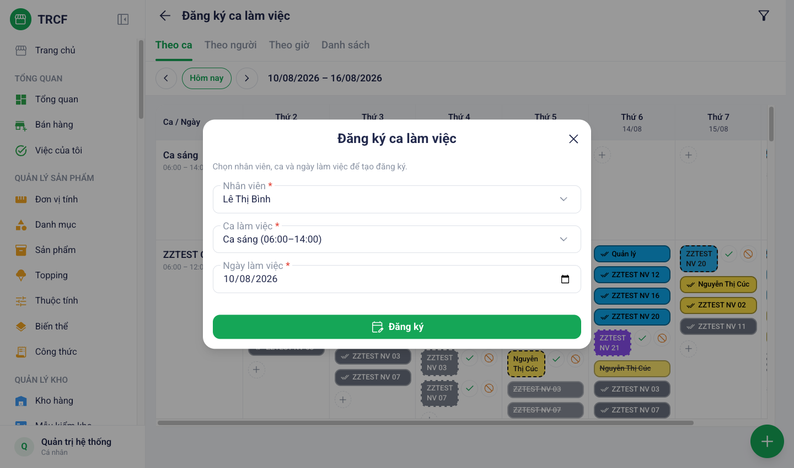
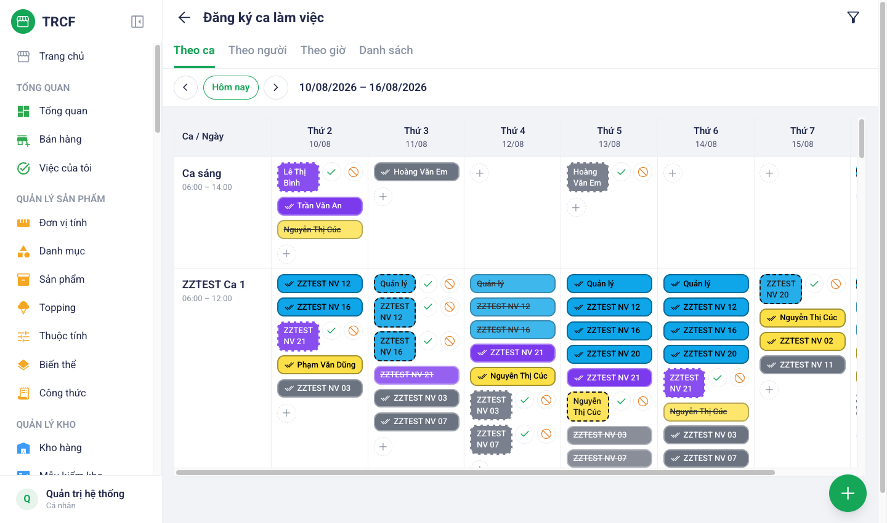
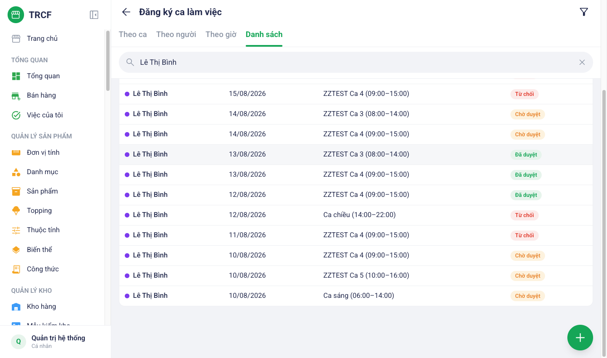
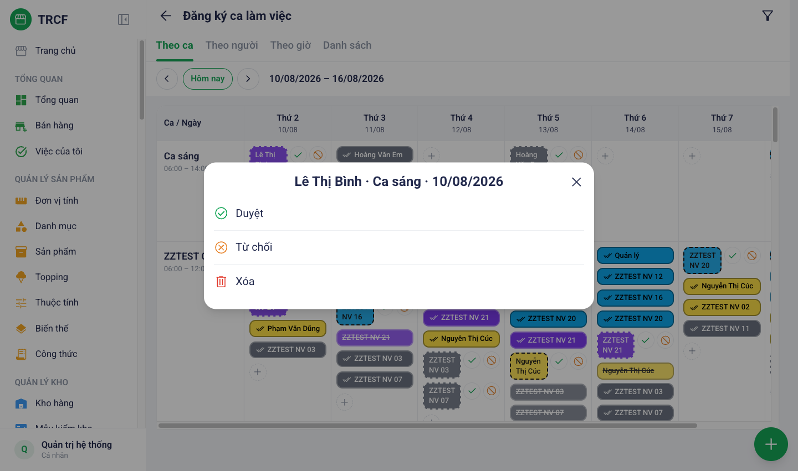

# 9.2 Đăng ký và duyệt ca

## 1. Đường dẫn vào chức năng

Menu trái: ==Quản lý nhân sự → Đăng ký ca== (địa chỉ `/shift-registrations`, tiêu đề trang **Đăng ký ca làm việc**).

- Bốn thẻ xem: **Theo ca** (lịch tuần, hàng là ca, cột là ngày), **Theo người**, **Theo giờ** và **Danh sách**.
- Ba trạng thái: **Chờ duyệt → Đã duyệt / Từ chối**.
- Cần có trước: nhân viên ([mục 8.1](8-1-tao-nhan-vien.md)), ca làm việc ([mục 9.1](9-1-tao-ca-lam-viec.md)).

## 2. Ví dụ nền và các bước thực hiện

> **Ví dụ:** đăng ký **Lê Thị Bình** làm **Ca sáng** ngày 10/08/2026, quản lý duyệt.
>
> - Đăng ký mới có trạng thái **Chờ duyệt**.
> - Quản lý bấm **Duyệt** → **Đã duyệt**.

### Bước 1: Khai phiếu đăng ký ca

- Vào **Quản lý nhân sự → Đăng ký ca**.
- Bấm nút tròn **+** ở góc dưới bên phải. Hộp thoại **Đăng ký ca làm việc** mở ra.
- **Nhân viên**: bấm vào ô, chọn **Lê Thị Bình**.
- **Ca làm việc**: bấm vào ô, chọn **Ca sáng (06:00–14:00)**.
- **Ngày làm việc**: chọn **10/08/2026**.
- Bấm **Đăng ký**. Phiếu mới luôn ở trạng thái **Chờ duyệt**.

### Bước 2: Xem trên lịch Theo ca

- Thẻ **Theo ca**: hàng là ca, cột là ngày. Bấm mũi tên hai bên để sang tuần trước/sau, **Hôm nay** để về tuần này.
- Ô **Ca sáng** ngày Thứ 2 10/08 hiện tên **Lê Thị Bình**.
- Tên **viền nét đứt**, kèm nút ✓ (duyệt) và ⊘ (từ chối): đang chờ duyệt.
- Tên **nền đặc** có dấu tích: đã duyệt. Tên **gạch ngang**: bị từ chối.
- Màu của tên theo phòng ban. Nút **+** trong ô để đăng ký thêm người cho ca đó.

### Bước 3: Xem trên Danh sách

- Bấm thẻ **Danh sách**.
- Gõ tên vào ô **Tìm theo tên nhân viên...** để lọc theo người.
- Bấm biểu tượng phễu góc trên phải để lọc theo **Từ ngày / Đến ngày**, **Ca làm việc**, **Trạng thái**.
- Cột **Trạng thái** hiện nhãn **Chờ duyệt**.

### Bước 4: Quản lý duyệt

- Bấm vào tên **Lê Thị Bình** trên lịch (hoặc vào dòng trong **Danh sách**).
- Chọn **Duyệt** (hoặc **Từ chối** nếu không đồng ý). Có thể bấm thẳng nút ✓ cạnh tên trên lịch.
- Tên chuyển sang **nền đặc**, trạng thái **Đã duyệt**.

## 3. Giải thích các trường

| Trường | Điền gì | Bắt buộc |
| --- | --- | --- |
| Nhân viên | Người làm ca | ✅ |
| Ca làm việc | Ca đã khai ở [mục 9.1](9-1-tao-ca-lam-viec.md) | ✅ |
| Ngày làm việc | Ngày làm | ✅ |

### Vì sao bắt buộc phải duyệt

Trạng thái **Đã duyệt** là đầu vào của hai việc khác:

| Việc | Phụ thuộc thế nào |
| --- | --- |
| **Sinh checklist công việc** ([7.1](7-1-mau-cong-viec.md)) | Chỉ chia việc cho người **đã được duyệt ca** hôm đó. Không ai duyệt: báo lỗi |
| **Phân tích trễ/sớm** ([9.3](9-3-dong-bo-cham-cong.md)) | So giờ quẹt thẻ với giờ ca **đã duyệt**. Chưa duyệt: cột trễ/sớm để trống |

## 4. Lưu ý quan trọng

> [!WARNING]
> **Bấm duyệt hai lần cho cùng bản ghi sẽ bị chặn.**
>
> - Trạng thái chỉ đi một chiều từ *Chờ duyệt*.

> [!TIP]
> Mỗi người chỉ có **một đăng ký còn hiệu lực** cho cùng ca, cùng ngày.
>
> - Đã có phiếu *Chờ duyệt* hoặc *Đã duyệt* thì đăng ký lại bị chặn, hệ thống báo phiếu đang chắn.
> - Phiếu bị *Từ chối* không chắn: nhân viên đăng ký lại được.

## Kiểm tra đã đúng

- [ ] Mọi ngày trong tuần tới đều có người được duyệt ca
- [ ] Lịch tuần hiện đủ người, đúng ca
