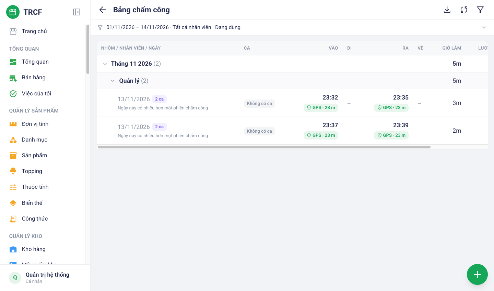
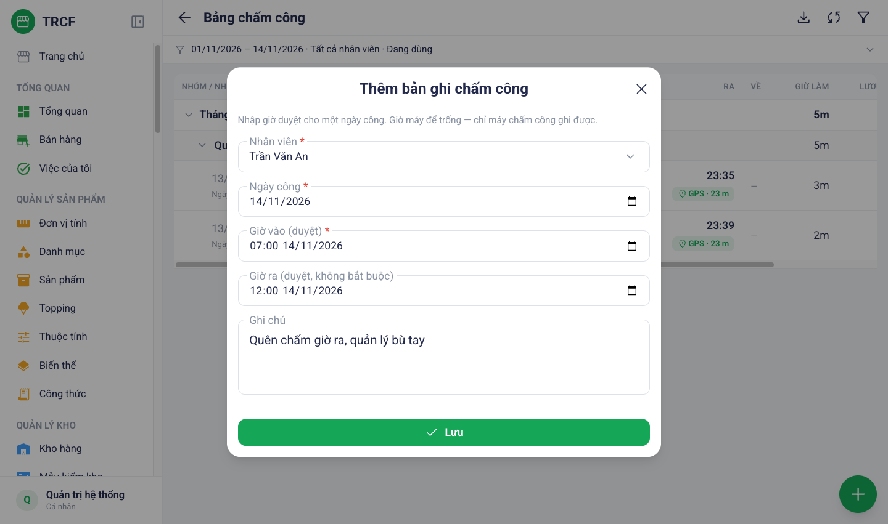

# 9.3 Đồng bộ chấm công

## 1. Đường dẫn vào chức năng

Menu trái: ==Quản lý nhân sự → Chấm công== (địa chỉ `/attendance`).

- Cần có trước: máy chấm công ([bài 8.2](8-2-cai-dat-may-cham-cong.md)) và ca **đã duyệt** ([bài 9.2](9-2-dang-ky-va-duyet-ca.md)).

## 2. Ví dụ nền và các bước thực hiện

> **Ví dụ:** kéo giờ chấm công từ máy, bù tay khi quên chấm.
>
> - Nhân viên **Trần Văn An** đã có ID Chấm công trên máy.
> - Quên chấm giờ ra: quản lý bù tay bằng **Thêm bản ghi chấm công**.

### Bước 1: Mở Bảng chấm công

- Ở menu trái, nhóm **Quản lý nhân sự**, bấm **Chấm công**.
- Bấm biểu tượng phễu góc trên phải để lọc theo **Nhân viên**, **Từ ngày / Đến ngày**, **Trạng thái**. Mặc định là từ đầu tháng đến hôm nay.
- Bảng gom theo tháng, rồi theo nhân viên, rồi theo ngày. Bấm mũi tên ở dòng tháng/nhân viên để mở hoặc gập.
- Dòng nhân viên có nhãn **N ngày thiếu giờ** nếu có ngày quên chấm.
- Cần bảng công ra tệp: bấm biểu tượng tải xuống (**Xuất Excel**).

### Bước 2: Đồng bộ từ máy chấm công

- Bấm biểu tượng hai mũi tên xoay góc trên phải (**Đồng bộ từ máy chấm công**).
- **Máy chấm công**: bấm vào ô, chọn máy. **Từ ngày / Đến ngày**: chọn khoảng **hẹp**.
- Bấm **Kiểm tra kết nối** trước cho chắc.
- Đọc kỹ khung cảnh báo vàng, rồi bấm **Đồng bộ**.
- Hệ thống ghép cặp vào–ra theo từng người từng ngày. Lượt lẻ cuối ngày để trống giờ ra.

### Bước 3: Bù tay khi quên chấm

- Bấm nút tròn **+** ở góc dưới bên phải. Hộp thoại **Thêm bản ghi chấm công** mở ra.
- **Nhân viên**: bấm vào ô, chọn **Trần Văn An**.
- **Ngày công**: chọn ngày làm.
- **Giờ vào (duyệt)**: nhập **07:00**. **Giờ ra (duyệt, không bắt buộc)**: nhập **12:00**.
- **Ghi chú**: nhập **Quên chấm giờ ra, quản lý bù tay**.
- Bấm **Lưu**.

## 3. Giải thích các trường

### Bù tay

| Trường | Điền gì | Bắt buộc |
| --- | --- | --- |
| Nhân viên | Người cần bù công | ✅ |
| Ngày công | Ngày làm việc | ✅ |
| Giờ vào (duyệt) | Giờ vào thật, quản lý xác nhận | ✅ |
| Giờ ra (duyệt, không bắt buộc) | Giờ ra thật. Bỏ trống nếu chưa biết | — |
| Ghi chú | Lý do bù tay | — |

Bù tay chỉ ghi **giờ duyệt**. Giờ máy để trống, chỉ máy chấm công ghi được.

### Đọc bảng công

| Dấu hiệu | Nghĩa |
| --- | --- |
| Dấu **—** màu hổ phách ở cột Đi hoặc Về | Quên chấm. Dòng nhân viên hiện **N ngày thiếu giờ** |
| Nhãn tím **2 ca** | Ngày đó người này có nhiều hơn một phiên chấm công |
| Nhãn xám **Không có ca** ở cột Ca | Ngày đó không có ca đã duyệt để so trễ/sớm |
| Nhãn dưới giờ vào/ra (VD **GPS**) | Nguồn của lượt chấm: máy chấm công, GPS hay nhập tay |
| Badge đỏ ở cột Đi | Đi trễ (hổ phách = đến sớm) |
| Badge xanh ở cột Về | Về muộn = làm thêm (đỏ = về sớm) |

Dung sai trễ/sớm chỉnh ở *Cấu hình hệ thống*, ô **Dung sai chấm công (phút)**, mặc định 5 phút. Lệch trong khoảng này tính là *Đúng giờ*. Các cột: nhóm/nhân viên/ngày, ca, vào, đi, ra, về, giờ làm, lương/giờ, thành tiền.

## 4. Lưu ý quan trọng

> [!CAUTION]
> **Đồng bộ ghi lại giờ máy trong cả khoảng ngày đã chọn.**
>
> - Áp cho những nhân viên có lượt chấm trên máy trong khoảng đó.
> - **Giờ duyệt và ghi chú được giữ lại.** Dòng không còn lượt chấm trên máy mà không có giờ duyệt hay ghi chú thì bị xoá.
> - Đừng kéo cả tháng nếu chỉ cần bù một ngày.

> [!TIP]
> Khoảng **10% số ngày công chỉ có một lượt chấm** (quên chấm vào hoặc ra).
>
> - Rà nhãn **thiếu giờ** **hằng tuần**, đừng đợi cuối tháng.

## Kiểm tra đã đúng

- [ ] Đồng bộ xong không còn báo mã chưa gán nhân viên
- [ ] Đã rà nhãn **thiếu giờ** và bù tay những ngày quên chấm
- [ ] Cột thành tiền có số (nếu đã khai Lương giờ)
