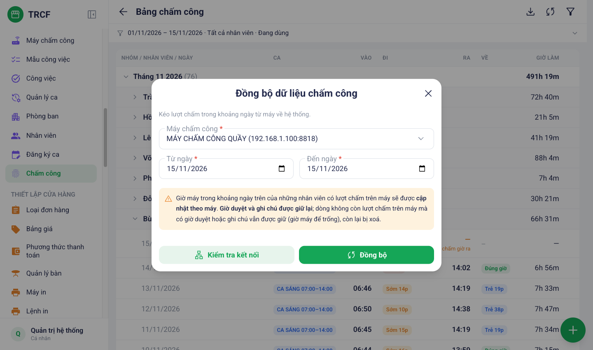

# 9.3 Đồng bộ chấm công

## 1. Đường dẫn vào chức năng

Menu trái: ==Quản lý nhân sự → Chấm công== (địa chỉ `/attendance`).

- Cần có trước: máy chấm công ([bài 8.2](8-2-cai-dat-may-cham-cong.md)) và ca **đã duyệt** ([bài 9.2](9-2-dang-ky-va-duyet-ca.md)).

## 2. Ví dụ nền và các bước thực hiện

> **Ví dụ:** ngày 15/11/2026, **Bùi Thảo Vy** làm **CA SÁNG** 07:00–14:00, quẹt vào lúc 06:45 nhưng quên quẹt ra.
>
> - Bảng công báo **1 ngày thiếu giờ**, cột Về ghi **Quên chấm giờ ra**.
> - Quản lý xác nhận bạn về lúc 14:00 và sửa giờ ra duyệt.

### Bước 1: Mở Bảng chấm công

- Ở menu trái, nhóm **Quản lý nhân sự**, bấm **Chấm công**.
- Bấm biểu tượng phễu góc trên phải để lọc theo **Nhân viên**, **Từ ngày / Đến ngày**, **Trạng thái**.
- Bấm mũi tên ở dòng tháng/nhân viên để mở hoặc gập.
- Cần bảng công ra tệp: bấm biểu tượng tải xuống (**Xuất Excel**).

### Bước 2: Đồng bộ từ máy chấm công

- Bấm biểu tượng hai mũi tên xoay góc trên phải (**Đồng bộ từ máy chấm công**).
- Chọn máy và khoảng ngày như ảnh. Chọn khoảng **hẹp**, ở đây chỉ ngày 15/11.
- Bấm **Kiểm tra kết nối** trước, rồi bấm **Đồng bộ**.
- Hệ thống ghép cặp vào–ra theo từng người từng ngày. Lượt lẻ cuối ngày để trống giờ ra.

### Bước 3: Bù tay khi quên chấm

- Mở dòng nhân viên, bấm vào ngày có **Quên chấm giờ ra**, chọn **Sửa**.
- Điền **Giờ ra (duyệt)** và **Ghi chú** như ảnh, bấm **Lưu**. Giờ máy giữ nguyên.
- Quên chấm cả ngày (không có dòng nào): bấm nút tròn **+** ở góc dưới bên phải để thêm bản ghi mới.

## 3. Giải thích các trường

### Bù tay

| Trường | Điền gì | Bắt buộc |
| --- | --- | --- |
| Nhân viên | Người cần bù công | ✅ |
| Ngày công | Ngày làm việc | ✅ |
| Giờ vào (duyệt) | Giờ vào thật, quản lý xác nhận | ✅ |
| Giờ ra (duyệt, không bắt buộc) | Giờ ra thật. Bỏ trống nếu chưa biết | — |
| Ghi chú | Lý do bù tay | — |

Bù tay chỉ ghi **giờ duyệt**. Giờ máy để trống, chỉ máy chấm công ghi được.

### Đọc bảng công

| Dấu hiệu | Nghĩa |
| --- | --- |
| Dấu **—** màu hổ phách ở cột Đi hoặc Về | Quên chấm. Dòng nhân viên hiện **N ngày thiếu giờ** |
| Nhãn tím **2 ca** | Ngày đó người này có nhiều hơn một phiên chấm công |
| Nhãn xám **Không có ca** ở cột Ca | Ngày đó không có ca đã duyệt để so trễ/sớm |
| Nhãn dưới giờ vào/ra (VD **GPS**) | Nguồn của lượt chấm: máy chấm công, GPS hay nhập tay |
| Badge đỏ ở cột Đi | Đi trễ (hổ phách = đến sớm) |
| Badge xanh ở cột Về | Về muộn = làm thêm (đỏ = về sớm) |

Dung sai trễ/sớm chỉnh ở *Cấu hình hệ thống*, ô **Dung sai chấm công (phút)**, mặc định 5 phút. Lệch trong khoảng này tính là *Đúng giờ*. Kéo ngang bảng để xem cột lương/giờ và thành tiền.

## 4. Lưu ý quan trọng

> - Đồng bộ ghi lại giờ máy trong cả khoảng ngày đã chọn: chỉ chọn đúng ngày cần.
> - Giờ duyệt và ghi chú được giữ lại.
> - Rà nhãn **thiếu giờ** hằng tuần.
